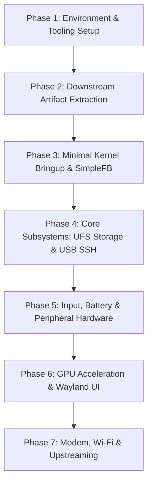

# OnePlus 7 Pro (`guacamole`) Nura Porting Plan

This roadmap outlines the systematic bringup and mainlining workflow for running **Nura** (formerly postmarketOS) on the **OnePlus 7 Pro** (Qualcomm Snapdragon 855 / SM8150).

---

## Technical Specifications Target

| Component | Specification |
| :--- | :--- |
| **SoC** | Qualcomm Snapdragon 855 (SM8150) |
| **CPU** | 8x Kryo 485 (1x 2.84 GHz Prime + 3x 2.42 GHz Gold + 4x 1.78 GHz Silver) |
| **GPU** | Qualcomm Adreno 640 |
| **RAM** | 6 GB / 8 GB / 12 GB LPDDR4X |
| **Storage** | 128 GB / 256 GB UFS 3.0 (4096-byte sector size) |
| **Display** | 6.67" Fluid AMOLED 3120x1440 (19.5:9), 90Hz |
| **Architecture** | `aarch64` |
| **Flash Method** | Android Fastboot (standard A/B partition layout, non-super) |

---

## Porting Milestones

---

### Phase 1: Environment & Tooling Setup
- [x] Link and verify `pmbootstrap` installation (`pmbootstrap.py` symlinked to `~/.local/bin/pmbootstrap`).
- [x] Configure repository directory structure (`device/`, `dts/`, `firmware/`, `scripts/`, `docs/`).
- [x] Initialize Git tracking and `.gitignore` for build trees and artifacts.
- [ ] Initialize `pmbootstrap init`:
  - Work path: `~/.local/var/pmbootstrap`
  - Vendor: `oneplus`
  - Device: `guacamole`
  - Channel: `edge` (testing/community)
- [ ] Link local `device/testing/*` into `pmaports` directory or set local aports overlay.

---

### Phase 2: Downstream Artifact Extraction
- [ ] Extract live device tree blob from running OxygenOS/TWRP:
  - Run `./scripts/extract_dtb.sh` to produce `extracted_dtb/device.dts`.
- [ ] Determine exact bootloader DTB matching parameters:
  - Extract `qcom,msm-id` (typically `0x153 0x0` for SM8150).
  - Extract `qcom,board-id` from downstream device tree for `guacamole`.
- [ ] Locate continuous splash framebuffer address:
  - Identify `cont_splash_region` in downstream device tree (base address, memory size).
- [ ] Analyze stock Android `boot.img`:
  - Run `pmbootstrap bootimg_analyze boot.img` to verify page size (4096), base address offsets, and kernel cmdline arguments.
- [ ] Extract stock firmware blobs from OxygenOS OTA `payload.bin` (modem, DSP, Wi-Fi/BT).

---

### Phase 3: Minimal Kernel Bringup & SimpleFB Output
- [ ] Configure minimal device tree (`dts/sm8150-oneplus-guacamole.dts`):
  - Setup root node compatible strings (`oneplus,guacamole`, `qcom,sm8150`).
  - Configure `chosen/framebuffer` node (SimpleFB at 1440x3120).
  - Cross-check `reserved-memory` nodes against `sm8150.dtsi` to prevent TrustZone/hypervisor panics.
  - Setup protected GPIO pins (`&tlmm { gpio-reserved-ranges = ...; }`).
  - Configure `ramoops` pstore memory node for kernel crash logs.
- [ ] Build kernel using `envkernel.sh`:
  - Set config: `make defconfig sm8150.config` (or apply `config-postmarketos-qcom-sm8150.aarch64`).
  - Enable `CONFIG_FB_SIMPLE=y`, `CONFIG_PSTORE=y`, `CONFIG_PSTORE_RAM=y`.
  - Compile with `./scripts/build_kernel.sh`.
- [ ] Test boot without modifying storage:
  - Run `./scripts/flash_boot.sh test` (`fastboot boot boot.img`).
  - Observe splash handoff to SimpleFB console/splash screen.
  - If reboot occurs, use `./scripts/ramoops.sh` to extract pstore panic logs.

---

### Phase 4: Core Subsystems (UFS Storage & USB Networking)
- [ ] Verify UFS 3.0 controller bringup:
  - Enable `&ufs_mem_hc` and `&ufs_mem_phy`.
  - Ensure sector size configuration (`deviceinfo_rootfs_image_sector_size="4096"`).
  - Verify detection of UFS LUN partitions (`/dev/sda`, `/dev/sde`, etc.).
- [ ] USB Type-C and Gadget networking:
  - Enable `&usb_1`, `&usb_1_dwc3`, `&usb_1_hsphy`, `&usb_1_qmpphy`.
  - Validate USB Ethernet gadget (`cdc_ether` / `rndis`).
  - Establish SSH connection to Nura initramfs over USB (`ssh root@172.16.42.1`).

---

### Phase 5: Input, Battery & Peripherals Bringup
- [ ] Hardware buttons:
  - Power button (PM8150 PMIC PON).
  - Volume Up / Down (`gpio-keys`).
  - Alert Slider (Tri-state switch GPIO mappings).
- [ ] Touchscreen:
  - Identify I2C / SPI bus for Samsung AMOLED digitizer (Synaptics / Goodix).
  - Configure interrupt GPIO and regulator power rails.
- [ ] Battery & Charging:
  - SM8150 PMIC fuel gauge (`qcom,smb1390` / `qcom,smb1355` / `pmi632`).
  - USB-PD charging negotiation.
- [ ] Ramoops / dmesg review:
  - Clean up regulator warnings and missing clock warnings.

---

### Phase 6: Graphics Acceleration & Desktop Environment
- [ ] Freedreno Adreno 640 GPU driver:
  - Configure `&gpu` node, GMU (`&gmu`), and GPU SMMU.
  - Load `a640_zap.mbn` microcode.
  - Validate Mesa Turnip / Freedreno DRI driver.
- [ ] Native Display DSI panel driver (transitioning from SimpleFB):
  - 90Hz Fluid AMOLED DSI command mode panel driver.
- [ ] Install desktop interface via Nura:
  - Build images with Phosh or Plasma Mobile.
  - Verify Wayland compositor launching and touch interaction.

---

### Phase 7: Modem, Connectivity & Upstreaming
- [ ] Ath10k / WCN3990 Wi-Fi bringup:
  - Debug WMI initialization error (`-108`) documented in Nura wiki.
  - Test calibration data extraction from `persist` partition (`board-2.bin`).
- [ ] Bluetooth (QCA WCN3990 HCI over UART).
- [ ] Hexagon DSP & Modem bringup (`remoteproc`, `qmic` / ModemManager).
- [ ] Upstreaming:
  - Submit `device-oneplus-guacamole` to `pmaports/device/testing`.
  - Propose device tree patch upstream to Linux kernel mailing list (`linux-arm-msm`).
