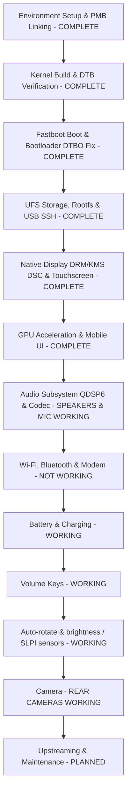

# OnePlus 7 Pro (`guacamole`) Nura Porting Plan

This roadmap outlines the bringup, integration, and testing workflow for running **Nura / postmarketOS** on the **OnePlus 7 Pro** (Qualcomm Snapdragon 855 / SM8150), detailing completed milestones and outlining our active development tasks.

---

## Technical Specifications Target

| Component | Specification |
| :--- | :--- |
| **SoC** | Qualcomm Snapdragon 855 (SM8150) |
| **CPU** | 8x Kryo 485 (1x 2.84 GHz Prime + 3x 2.42 GHz Gold + 4x 1.78 GHz Silver) |
| **GPU** | Qualcomm Adreno 640 (`qcom,adreno-640.1`) |
| **RAM** | 6 GB / 8 GB / 12 GB LPDDR4X |
| **Storage** | 128 GB / 256 GB UFS 3.0 (4096-byte sector size, `/dev/sda` - `/dev/sdf`) |
| **Display** | 6.67" Fluid AMOLED 3120x1440 (19.5:9), 90Hz Command-Mode DSC |
| **Digitizer** | Samsung `s6sy761` I2C Touchscreen (`&i2c17` at `0x48`) |
| **Audio Codec** | Qualcomm WCD9340 / WCD9341 via QDSP6 ADSP |
| **Architecture** | `aarch64` |
| **Access Method** | USB Ethernet Gadget (`172.16.42.1`) + Wayland/Phosh GUI |

---

## Bringup Phase Overview

---

## Detailed Status by Phase

### Environment Setup & Package Linking
- [x] Configure repository directory structure (`device/`, `dts/`, `firmware/`, `scripts/`, `docs/`).
- [x] Pull and import upstream device tree and device integration packages.
- [x] Initialize `pmbootstrap` configuration (`~/.config/pmbootstrap_v3.cfg`).
  - Work path: `~/.local/var/pmbootstrap`
  - Vendor: `oneplus`, Device: `guacamole`, Kernel: `postmarketos-qcom-sm8150`
- [x] Symlink local package folders into `aports`:
  - `device/testing/device-oneplus-guacamole`
  - `device/testing/firmware-oneplus-guacamole`
  - `device/testing/linux-postmarketos-qcom-sm8150`

---

### Kernel Build & DTB Verification
- [x] Verified `sm8150-oneplus-guacamole.dtb` in mainline kernel tree.
- [x] Built `firmware-oneplus-guacamole` package (GPU zap shader, WCN3990 WiFi data, modem FW).
- [x] Built `device-oneplus-guacamole` package.
- [x] Assembled rootfs and generated initramfs via `pmbootstrap install`.

---

### Bootloader Mechanics & DTBO Zeroing
- [x] Diagnosed early boot stall: OnePlus ABL dynamically injected `/dev/block/by-name/dtbo_b` Qualcomm BSP overlays into RAM, corrupting mainline DTB nodes.
- [x] Backed up stock DTBO partition to `backups/dtbo_b.img`.
- [x] Zeroed active slot DTBO (`dd if=/dev/zero of=/dev/block/by-name/dtbo_b`), allowing clean mainline DTB execution.
- [x] Verified EFI stub decompression, SMP bringup on all 8 Kryo cores, and successful initramfs execution.
- [x] Untethered boot (2026-11-22): `build/boot.img` (kernel r25) flashed to `boot_b`, the active slot with the zeroed DTBO. Boots from power-on with no PC; verified identical to the `fastboot boot` path (modules, Wi-Fi, services, touch, audio, charger). `boot_a` holds an old pmOS image but slot a keeps its stock DTBO and would switch xbl/abl too, so it is not used. `vbmeta_b` unchanged (verification enabled, tolerated while unlocked); backups: `stock_boot_full.img` (boot_b, hash verified), `backups/vbmeta_b.img`.
- [x] Reboot into fastboot from a flashed system (2026-11-22). A `fastboot boot`ed kernel never needed a reboot reason (the ABL re-enters fastboot after a `fastboot boot`), which hid three problems:
  - The PON node had no reboot modes. Added `mode-bootloader = <0x02>`, `mode-recovery = <0x01>` on `pon@800` (Qualcomm `PON_RESTART_REASON_*` values, as in `pm8998.dtsi`) and the IMEM `sram@146bf000` / `reboot-mode@65c` node (`0x77665500` bootloader, `0x77665502` recovery) from the hotdog bringup; `CONFIG_POWER_RESET_QCOM_PON` and `SYSCON_REBOOT_MODE` were already built in. A raw `reboot(RESTART2, "bootloader")` then reaches fastboot.
  - systemd 262 ignores the positional argument of `reboot bootloader`; `systemctl reboot --reboot-argument=bootloader` writes `/run/systemd/reboot-param`, which `systemd-shutdown` passes to the kernel.
  - With Wi-Fi connected the reason was lost anyway (4 of 5 attempts booted normally, 32 s cycle; Wi-Fi off: 3 of 3 fastboot, 18 s). `rmtfs -r` stops the modem remoteproc on exit, while `wlan0` is still up and the WLAN firmware holds the MSA region, and the reset that follows is a hard one. `guacamole-wlan-down.service` (device r12, `After=rmtfs.service`, `Before=NetworkManager.service`, `ExecStop=ip link set wlan0 down`) brings the link down first: 3 of 3 reboots with Wi-Fi connected reached fastboot. Lesson from the first attempt: systemd expands `${...}` in `Exec*` lines, so a shell loop there silently did nothing.
  - Evidence limits: `system-shutdown/` hooks run after the filesystems are unmounted, pstore/ramoops does not survive these reboots, and journald stops before `rmtfs`. Unit stop order was recorded with `ExecStop`/`ExecStopPost` drop-ins writing to `/var/lib/guacamole`.
  - Open: the kernel side. ath10k keeps the MSA region assigned while the modem is stopped under it; the hotdog MSA-reclaim patches cover Wi-Fi survival after a modem crash, not a clean release before a modem stop.

---

### UFS Storage, Rootfs & USB Gadget Networking
- [x] UFS 3.0 detection verified via `ufshcd-qcom` (`/dev/sda` through `/dev/sdf`).
- [x] Rootfs deployed on `/dev/sda13` (`system_a`, inactive slot `_a`), preserving stock Android on slot `_b`. It was later reinstalled on `userdata` (LUN 0, partition 19) to use the full storage.
- [x] UFS write integrity at HS-G3 (kernel patch `0010`) — verified 2026-10-11
  - At HS-G4 the link took repeated data-link TCx replay (`saved_uic_err 0x4`) and PA (`0x40`) errors; each recovery completed in-flight commands with `OCS invalid` and buffered writes were lost (96 KiB runs read back as zeros). This corrupted downloads, the module index, `/etc/apk/world` and firmware files.
  - Verified with 4 × 1 GiB patterned buffered writes after `drop_caches`: HS-G4 232 bad blocks / 20 UFS error recoveries / 191 `OCS invalid`; HS-G3 0 / 0 / 0. O_DIRECT writes were always intact; RAM held a 5 GiB pattern cleanly; the reserved-memory map matches the stock union.
- [ ] Stable disk naming: LUN 0 is not always `sda` because the LUNs probe asynchronously, and GNOME Settings then reports the first LUN's size (for example 8.4 MB). Test `scsi_mod.scan=sync`.
- [x] Configured USB Ethernet gadget networking (`cdc_ncm` / `rndis`).
- [x] Direct SSH access operational at `ssh user@172.16.42.1`.
- [x] **USB host (OTG)** — verified 2026-10-12
  - Before: a USB thumb drive did not show up at all. The DWC3 controller (`usb@a600000`) was fixed to `dr_mode = "peripheral"`, and the PM8150B Type-C port (`typec@1500`) and VBUS regulator (`usb-vbus-regulator@1100`) were disabled.
  - Fix (device tree only; the kernel config already had `TYPEC_QCOM_PMIC`, `USB_ROLE_SWITCH`, `USB_DWC3_DUAL_ROLE` and `REGULATOR_QCOM_USB_VBUS`): enabled both PM8150B nodes, gave the Type-C port a dual-role `usb-c-connector` (`vdd-pdphy-supply` = the HS PHY 3.1 V rail, source PDO 5 V / 1.5 A, sink PDO 5 V / 3 A), switched the controller to `dr_mode = "otg"` with `usb-role-switch`, and connected the connector to the controller's HS port (data role) and to the QMP combo PHY (`orientation-switch`, SuperSpeed lanes). Modelled on `hotdog-linux-bringup` patches 0048/0049.
  - Verified: a SanDisk thumb drive (`0781:55a9`) enumerated at SuperSpeed on `xhci-hcd` and opened in Files. Attached to a PC the port reports `[sink]` / `[device]`, USB gadget SSH works and the VBUS boost stays off.
  - Not done: the FSA4480 SBU/audio switch (`i2c@890000` 0x42 in the stock DT) and DisplayPort alternate mode.

---

### Display (DRM/KMS DSC) & Touchscreen Bringup
- [x] **Samsung Command-Mode DSC Display**:
  - Replaced frozen `simplefb` with native DRM/KMS `panel-samsung-oneplus-dsc` driver.
  - Patched MSM DSI host driver (`dsi_host.c`) for 2 DSC slices per packet (720px each for 1440px width).
  - Configured 1440x3120 Fluid AMOLED panel running at native 90Hz.
- [x] **Samsung S6SY761 Touchscreen**:
  - Mapped `vdd-supply` and `avdd-supply` to PM8150 LDO 17 (`vreg_l17a_3p0`, 3.0V).
  - Configured GPIO 119 pull-up to enable the 1.8V digital rail.
  - Digitizer registered on `/dev/input/event1` with multi-touch support.

---

### GPU Hardware Acceleration & Phosh UI
- [x] Adreno 640 hardware acceleration operational:
  - GMU firmware `a640_gmu.bin` (v2.0.261) and SQE firmware `a630_sqe.fw` loaded.
  - Secure ZAP shader `a640_zap.mdt` authenticated into `zap-shader` memory.
  - DRM/KMS Freedreno OpenGL ES 3.2 and Mesa Turnip Vulkan 1.3 drivers active.
- [x] Phosh / Phoc Wayland shell running at 90 Hz.

---

### Audio Subsystem Bringup
- [x] **ADSP Remoteproc Enablement**
  - Verified Hexagon ADSP PAS firmware (`adsp.mdt`, `adsp.b*`) loads.
  - Remote processor `remoteproc1` (adsp) confirmed in `running` state.
- [x] **Sound Card & QDSP6 Audio Routing**
  - Populated `q6asmdai` sessions (`dai@0` through `dai@5`) resolving probe failure `-22`.
  - Added labels and DAIs for `q6afedai`, `q6afecc`, and `q6routing`.
  - Configured SM8150 sound card node (`qcom,sm8150-sndcard`) with MultiMedia 1-6 frontend links.
- [x] **Codec Hardware Integration**
  - Enabled SLIMbus NGD controller (`qcom,slim-ngd-v2.1.0`) at `slim-ngd@171c0000`.
  - Configured Qualcomm WCD9340 ("Tavil") audio codec node (`slim217,250`) on SLIMbus with GPIO 123 IRQ, GPIO 143 reset, and 1.8V PM8150 S4 power rail.
  - Linked SLIMbus Playback/Capture 1 & 2 to WCD9340 AIF1 and AIF2.
  - Rebuilt boot image `build/boot.img` with patched DTS.
- [x] **Stereo Speakers (NXP TFA9874 x2)** — verified 2026-10-11
  - Loudspeakers are not on the WCD9340: two NXP TFA9874 amplifiers (rev `0x0c74`) at I2C `0x34` (top/earpiece, slot 0) and `0x35` (bottom, slot 1) on `i2c@890000` (QUP0 SE4), fed by `QUATERNARY_MI2S_RX` (GPIO 137-140, data on SD1).
  - Stock `/vendor/firmware/tfa98xx.cnt` and `mixer_paths_tavil.xml` (copied to `build/audio_ref/stock_vendor_b/`) match the OnePlus 7T Pro (`hotdog`) profile exactly; ported its `tfa9874` driver and SM8150 MI2S backend as kernel patches `0007`/`0008` (S24_LE, 48 kHz, 3.072 MHz BCLK).
  - Left/right channels verified with the GNOME sound test.
- [ ] **Internal Microphone** — WIP
  - OxygenOS `handset-mic` path: AMIC4 → ADC4 → DEC0 → SLIM TX0 → `SLIMBUS_0_TX` → MultiMedia2 (PCM 1), biased by MIC BIAS1.
  - While ALSA routing sequences were verified, the QDSP6 AFE port start fails with `-22` (`EINVAL`) during runtime DAI prepare on `SLIMBUS_0_TX`. Bundling `Mic` into the UCM `HiFi` use-case caused PipeWire ACP probing to reject the sound card entirely; commented out in `HiFi.conf` until the kernel SLIMbus DAI channel mapping is resolved.
- [x] **UCM2 & PipeWire / WirePlumber Sound Server** — verified 2026-11-12
  - `device-oneplus-guacamole` installs `conf.d/sm8150/OnePlus 7 Pro.conf` + `OnePlus/guacamole/HiFi.conf` (Speaker).
  - Resolved PipeWire volume attenuation: PipeWire defaulted to `S24_32LE` format for `hw:Pro,0`, which caused TDM slot MSB misalignment in the Qualcomm DSP and ~ -48 dB digital attenuation ("ultra low volume" at 100%).
  - Added `51-oneplus-sound.conf` WirePlumber rule enforcing `audio.format = "S16LE"` and `audio.rate = 48000`, restoring full acoustic volume across both speakers in Phosh, GNOME Settings, and all applications.
- [ ] **Remaining audio work**
  - Fix kernel SLIMbus DAI channel mapping for `SLIMBUS_0_TX` so internal microphone capture works without AFE error `-22`.
  - Earpiece-only "receiver" profile for calls (top TFA, stock `handset` path) and voice call routing (depends on the modem bringup).
  - Secondary/ANC microphones (AMIC1/AMIC3/AMIC5) and noise-suppression dual-mic capture.
  - Speaker protection (stock uses ADSP feedback via `QUAT_MI2S` TX / VI sense); conservative default volume and thermal testing.
  - WCD934x SoundWire controller probe fails `-22` (harmless: no WSA amps on this phone).
  - Remove the stray unpackaged UCM files on the device (`/usr/share/alsa/ucm2/Qualcomm/sm8150/`, `conf.d/sm8150/sm8150.conf`, `conf.d/OnePlus 7 Pro/`) that route speakers via SLIMbus.

---

### Wi-Fi, Bluetooth & Modem Bringup
Wi-Fi connects on 2.4 GHz and 5 GHz and Bluetooth works. Cellular is not working yet.

- [x] **Modem / MPSS remoteproc**
  - `remoteproc0` (modem) reaches `running` with `qcom/sm8150/oneplus7/modem.mdt` from `firmware-oneplus-guacamole`; `rmtfs` and `tqftpserv` are active, and the in-kernel pd-mapper replaces the userspace one.
  - The packaged modem/WLAN firmware (`WLAN.HL.3.2.0.c2-00011`) is a different OxygenOS build than the phone's own `modem_b` (`c2-00006`); both behave the same for Wi-Fi.
- [x] **WCN3990 Wi-Fi (`ath10k_snoc`)** — connects on 2.4 and 5 GHz, verified 2026-10-11
  - Supplies from the stock `qcom,icnss` node: L1A (cx-mx), L7A (1.8 V xo), L2C (1.3 V rfa), L11C (3.3 V ch0). No separate ch1 rail; stock uses L10C for audio.
  - Firmware: the OxygenOS 10/11 WLAN firmware (`WLAN.HL.3.2.0`) rejects station vdev start under mainline ath10k. `firmware-oneplus-guacamole` now ships the OxygenOS 12-era `wlanmdsp.mbn` (`WLAN.HL.3.0.c8-00232`) and board data from a LineageOS OTA (`scripts/extract_lineage_firmware.py`, local tarball next to the APKBUILD), plus `firmware-5.bin` from linux-firmware `20260810`.
  - Re-test of the sm8150-mainline GitLab firmware (2026-10-12, UFS at HS-G3): its `wlanmdsp.mbn` alone, and its full modem + `wlanmdsp.mbn` + `board-2.bin` set, both fail station vdev start (`status error: -1`) on 2.4 GHz and 5 GHz. The earlier failure was not caused by storage corruption; the LineageOS firmware stays. Note for future tests: pmOS overrides `firmware_class.path` at boot, so swap test firmware with bind mounts from an early oneshot unit instead.
  - The OxygenOS 12 modem image spans 160 MiB (`0x8dc00000-0x97c00000`) and fails with "segment outside memory range" against the 150 MiB `mpss_mem`, so the package keeps the OxygenOS 11 modem.
  - Kernel patch `0009`: skip the WMI quiet-mode command on WCN3990 (HL3.2 firmware crashed on it), backported from the linux-wireless series "ath10k: WCN3990 firmware workarounds for WLAN.HL.3.2". Its forced-passive-5 GHz half is not included.
  - Do not test by unbinding/rebinding `ath10k_snoc` or restarting a running modem: the MSA region stays assigned to the modem (`qcom_scm` assign `-22`), and rebooting from that state has put the phone into Qualcomm crashdump mode.
  - MAC address (2026-10-12): `ath10k` logs `invalid MAC address; choosing random` because neither the device tree nor the firmware carries the factory MAC. `guacamole-wlanmac` (udev `RUN+=` on the `wlan0` add event, before NetworkManager manages the device) reads `Intf0MacAddress` from `persist/wlan_mac.bin` with `debugfs` (udevd's seccomp filter blocks `mount`), caches it in `/var/lib/guacamole/wlanmac` and sets it as the interface address. NetworkManager keeps the pmOS policy (`50-random-mac.conf`): randomized scan MACs and a per-connection `stable` MAC while connected, which stays the same across reboots (verified for two saved networks). A connection can use the factory MAC with `802-11-wireless.cloned-mac-address=preserve`. The kernel `perm_addr` (NetworkManager `PermHwAddress`, used by `cloned-mac-address=permanent`) stays random; fixing that needs the MAC in the device tree before `ath10k` registers the interface.
  - Still to do: WoWLAN sleep/wake, throughput; `rmtfs` sometimes starts before `remoteproc0` registers (`failed to update start state: Invalid argument`) and the modem then needs a manual `echo start`.
- [x] **Crashdump on reboot** — fixed 2026-10-12
  - Symptom: `reboot bootloader` with Wi-Fi active sometimes dropped the phone into Qualcomm crashdump mode (2026-10-11, at least twice; recover with Power + Volume Up). Reboots with the radio off went straight to fastboot.
  - Cause: the boot firmware arms a download-mode cookie in TCSR. `qcom_scm` clears it at probe and in its shutdown hook, but the device tree had no `qcom,dload-mode`, so the driver used the `SET_DLOAD_MODE` SCM call, which does not clear the cookie on SM8150. An abnormal event during shutdown with the modem running the WLAN firmware then ended in download mode.
  - Fix: TCSR syscon `syscon@1fc0000` (size `0x30000`) and `qcom,dload-mode = <&tcsr 0x13000>` on `firmware/scm`, from `hotdog-linux-bringup` patch `0098` (downstream places the register at `0x1fd3000`).
  - Verified: reboots to fastboot with Wi-Fi connected went cleanly 3 times in a row (2 logged over SSH with distinct boot IDs, 1 observed on the device).
  - Not investigated: what fails in the modem/WLAN shutdown path. The cookie fix stops it from forcing a crashdump; the hotdog "ath10k MSA reclaim" patches (`hotdog-linux-bringup/docs/upstream-submissions.md`) address the modem-crash side.
- [ ] **Move to the OxygenOS 12 modem**: rework reserved memory so `mpss_mem` covers 160 MiB (moves `venus_mem` and the following regions; see the NetHunter Pro guacamole patch 0008).
- [x] **WCN3990 Bluetooth (`hci_qca`)**, scanning and a Bluetooth mouse verified 2026-10-12
  - UART13 (`serial@c8c000`, GPIO 43–46) with a `qcom,wcn3990-bt` child: `vddio` L1A, `vddxo` L7A, `vddrf` L2C, `vddch0` L11C, 3.2 Mbaud (same as `sm8150-google-flame` and the OnePlus 7T Pro).
  - `qcom_geni_serial` needs a `serial1` alias in `/aliases`; without it the UART fails with "Invalid line -19".
  - ROM version `0x1001` would derive rev-01 firmware names, so the node sets `firmware-name = "crnv21.bin", "crbtfw21.tlv"`. Both files come from the LineageOS `bluetooth` partition (`BTFM.CHE.2.1.5`) via `scripts/extract_lineage_firmware.py`, packaged in `firmware-oneplus-guacamole` r4.
  - The `linux-firmware` files (`20260810`: `crbtfw21.tlv` `BTFM.CHE.2.1.3`, generic `crnv21.bin`) also work: setup, scanning and a paired MX Master 3S tested 2026-10-12 by bind-mounting them and rebinding `hci_uart_qca`. They are the fallback if the LineageOS extraction is dropped; the package keeps the newer LineageOS build with OnePlus NV data.
  - The controller has no programmed address and ABL passes no `local-bd-address`, so the kernel registers it as unconfigured and BlueZ ignores it ("no adapter" in GNOME Settings). `device-oneplus-guacamole` r5 adds `guacamole-bdaddr` (udev rule and oneshot service). On first run it derives a stable address from the factory Wi-Fi MAC in `persist/wlan_mac.bin` (last byte + 1), caches it in `/var/lib/guacamole/bdaddr`, and applies it with `btmgmt public-addr` once the controller reports the address missing (it waits up to 20 s, since udev starts it before the QCA firmware setup finishes). Verified on a fresh boot 2026-10-12. The stock `persist/bluetooth` directory is empty, so the real address lives in modem NV.
  - Still to check: audio profiles (A2DP/HFP need the audio routing work), and Bluetooth/Wi-Fi coexistence under load.
- [x] **IPA data path and ModemManager detection** — verified 2026-10-13
  - ModemManager found the QMI modem over QRTR but refused it ("Failed to find a net port in the QMI modem"): mainline 6.17 has no IPA v4.1 (SM8150) support, so there was no `rmnet_ipa0`.
  - Kernel patches `0013` (IPA v4.1 platform data) and `0014` (v4.1 register definitions) from `hotdog-linux-bringup` 0144/0145, `0015` (bounded `gsi_trans_commit_wait()`, so a modem crash cannot wedge recovery from the SSR notifier) and `0016` (`ENDP_INIT_CTRL` for v4.1, used by `ipa_endpoint_program_delay()` below v4.2), both from hotdog 0156.
  - Device tree: `ipa@1e40000` (`qcom,sm8150-ipa`, SIDs 0x520/0x522, SPI 311/432, `RPMH_IPA_CLK`, interconnects memory/imem/config, `qcom,qmp`), `ipa-ap-to-modem`/`ipa-modem-to-ap` entries under `smp2p-mpss`, a phandle on `system-noc`, and `qcom,gsi-loader = "self"` with `memory-region` = the stock `pil_ipa_fw_region` (`0x98b00000`, 64 KiB) and `firmware-name = "qcom/sm8150/oneplus7/ipa_fws.mbn"`.
  - Firmware: `ipa_fws.mbn` is the single-file `ipa_fws.elf` from the LineageOS `vendor` partition (`/firmware/`), extracted by `scripts/extract_lineage_firmware.py` with `debugfs`; packaged in `firmware-oneplus-guacamole` r5. The stock `vendor_b` copy and the sm8150-mainline GitLab copy are different builds with the same layout; the stock copy was used for the first boot.
  - Result: "IPA driver setup completed successfully", modem starting/running events, `rmnet_ipa0` created, and ModemManager creates the modem (`qcom-soc`, ports `qrtr0` and `rmnet_ipa0`, IMEI and MPSS revision read). State is `failed: sim-missing`; UIM reports both physical slots `absent`.
  - Not applied from hotdog 0156: the IPA `no_system_suspend` diagnostic, the remoteproc proxy power-domain hold and wdog/fatal IRQ wakeups (candidates for the suspend work).
- [ ] **Cellular data & calls** (needs a SIM)
  - Test SIM detection and `msm-modem-uim-selection`, registration, SMS, mobile data (`rmnet` QMAP links over `rmnet_ipa0`), and voice calls (voice audio depends on the audio subsystem work).

---

### Battery & Charging
Battery percentage, charging and the plugged-in/unplugged state work. The charge-limit daemon still needs rework.

- [x] **Fuel gauge** — verified 2026-10-11
  - `ti,bq27411` at `0x55` on `i2c@a80000` (QUP1 SE8, GPIO 88/89), FIFO mode without GPI DMA, 100 kHz. Stock names it `bq27541`, but the registers follow the bq27411/bq27421 layout (as found on the OnePlus 7T Pro, `hotdog-linux-bringup` patch 0054).
  - No `monitored-battery` property, and `CONFIG_BATTERY_BQ27XXX_DT_UPDATES_NVM` is off, so the factory-programmed gauge data memory is never written.
  - Reports capacity, voltage, current, temperature, `charge_full` 2977 mAh vs. 3940 mAh design. UPower/Phosh show the percentage.
  - Still to check: unplugged discharge (negative current, percentage falling in step with `charge_now`). The first readings were taken at 100% after a day on USB.
  - The OnePlus Warp fast-charge MCU at `0x26` on the same bus is intentionally not described.
- [x] **PM8150B charger (SMB5)**, verified 2026-10-12
  - Kernel patch `0011`: `qcom_smbx` used SMB2 conversions on SMB5 hardware (about 4.85 V / 3.9 A on PM8150B). It now uses generation-specific ranges, keeps charging and USB input suspended until the limits are programmed, defines the SMB5 ICL bits and reruns AICL after ICL changes. Backported from `hotdog-linux-bringup` patches 0020, 0155 and 0150; 0151/0152 do not apply to this base.
  - `simple-battery` node with conservative limits below stock (stock `fv-max-uv` 4.365 V; `OP_4000mAh` profile 4.37 V and 3.0 A): 4.35 V float, 1.5 A fast charge, 310 mA termination, 4000 mAh. `charger@1000` is enabled with `monitored-battery`. The PM8150B fuel gauge stays disabled because the bq27411 is the battery source.
  - Registers read back through `/sys/kernel/debug/regmap/0-02/registers`: `0x1070` = `0x4b` (4.35 V), `0x1061` = `0x1e` (1.5 A), `0x1370` = `0x0a` (500 mA ICL on a PC SDP port), `0x1006` = fast-charge state.
  - Kernel patch `0012` with `power-supplies = <&pm8150b_charger>` on the gauge: the bq27411 kept its full-charge flag after unplugging, so it reported `Full` while discharging and UPower/Phosh still showed the charging bolt. It now reports `Full` only while the charger is online.
  - 2026-10-14: fast-charge current raised to 3 A (`constant-charge-current-max-microamp`), the current of the stock non-Warp "OP_4000mAh" profile (`qcom,fastchg-current-ma` 3000; the Warp profile uses 5400). Float voltage stays 4.35 V. The charger's own limits are 8 A FCC / 5 A ICL (`pm8150b` match data), so no driver cap had to change.
  - Kernel patches `0018` (USB3 SDP: SMB5 honours a 900 mA SDP limit only with the USB3 ICL option bits) and `0019` (`input_current_limit` property, readable and writable), from hotdog 0151/0152. The DWC3 node now carries `usb-psy-name = "pm8150b-charger"`, so the USB gadget reports its configured `bMaxPower` to the charger on a PC port.
  - USB PD: the connector sinks the stock capabilities (`qcom,default-sink-caps`: 5 V/3 A, 9 V/3 A, 12 V/2.25 A, `op-sink-microwatt` 27 W). The charger's input allowance register (`0x1360` = `0x07`, 5 V or 9–12 V) already accepts those, and stock disables QC (`qcom,hvdcp-disable`), so PD is the fast-charge path on mainline.
  - DCP verified 2026-10-14 on a plain 5 V adapter: BC1.2 reports DCP, the daemon sets 1.8 A (`0x1370` = `0x24`).
  - USB PD on a Steam Deck 45 W charger: Source_Capabilities (5 V/3 A, 9 V/3 A, 15 V/3 A, 20 V/2.25 A) arrive, TCPM requests 9 V/3 A and gets Accept, then about 70 ms into the voltage ramp the PMIC reports "VBUS off", the port detaches and the contract restarts forever (visible as charging/not-charging flicker). Cause: the input voltage window (`USBIN_ADAPTER_ALLOW_CFG`, `0x1360` = `0x07`, "5 V or 9 V to 12 V") treats the 5–9 V ramp as invalid input. That register is not writable from the driver (a first attempt left it at `0x07`); the stock driver instead programs `USBIN_ADAPTER_ALLOW_OVERRIDE` (`0x1344`) with `FORCE_5V`/`FORCE_9V`/`FORCE_12V` for a fixed PD contract or `CONTINUOUS` (bit 3) for a range, before the request (`smblib_set_usb_pd_allowed_voltage` in `smb5-lib.c`). Kernel patch `0020` programs `CONTINUOUS` after init and on every plug-in interrupt and logs the read-back (`input window override (init): readback=0x08`; the init-table write did not stick, the explicit write does). With the override in place the failure was unchanged, so the window was not the trigger.
  - Actual trigger: the Type-C port driver (`qcom_pmic_typec_port`) takes VBUS presence from `TYPEC_MISC_STATUS` bit 5 (`TYPEC_VBUS_DETECT`), which the stock headers do not even define; it behaves as "VBUS at vSafe5V" and clears when the source steps to 9 V, so TCPM reports "VBUS off" and detaches mid-transition. Stock takes presence from the charger's `USBIN_PLUGIN_RT_STS`. Kernel patch `0021` also counts VBUS as present when `TYPEC_SM_STATUS` says it is not at vSafe0V; it changed nothing, because the diagnostics (`0023`, logging the port status on every VBUS interrupt) show the hardware state machine itself exiting Attached.SNK: at the drop `TYPEC_MISC_STATUS` = `0x02` (no VBUS detect, no CC attached) and `TYPEC_SM_STATUS` = `0xc1` (USBIN below LV, vSafe0V), i.e. the Type-C block treats VBUS outside its 5 V window as removed and drops CC, which TCPM correctly reports as a detach. In the same capture one 9 V attempt completed (PS_RDY at +86 ms, before the exit fired), so it is a race against the source's ramp time.
  - Fix: `EXIT_SNK_BASED_ON_CC` (bit 0 of `TYPE_C_EXIT_STATE_CFG`, `0x1550`), which stock sets around PD hard resets so the sink state follows CC only; kernel patch `0024` sets it at init. Verified: with `0024` the 9 V/3 A contract completes every time (Accept, PS_RDY at +85 ms, SNK_READY, identity exchange).
  - Patch `0022` makes the charger follow TCPM's `tcpm-source-psy` supply: the Rp current at attach, the 500 mA standby limit between Accept and PS_RDY (required of a sink during a voltage step), the contract current afterwards, and the input window override for the contract voltage (`FORCE_5V`/`FORCE_9V`/`FORCE_12V`, `CONTINUOUS` otherwise), because with the contract at 9 V and only `CONTINUOUS` set the charger rejected the input (USBIN read 0 V, charger state "paused", `online` 0). The first attempt lost to the plug-in interrupt, which fires 0.6 ms after PS_RDY when the input re-validates at 9 V and rewrote `CONTINUOUS`; the handler now re-applies the contract window. With the FORCE_9V window held, the charger still rejects the input: `USBIN_INT_RT_STS` (`0x1310`) reads `0x26` = `USBIN_UV` + `USBIN_VASHDN` + `USBIN_REVI`, the charger's USBIN ADC reads 0 V, and the Type-C block's `TYPEC_SM_STATUS` reads vSafe0V and "USBIN below LV", all while the PD contract is at 9 V and the source sends PS_RDY. The PMIC never sees the 9 V; a board-level over-voltage switch on the VBUS path is the likely reason (the OnePlus Warp design runs at 5 V/6 A and the 7 Pro is quoted at 15 W on USB-PD). The stock 9 V/12 V sink capabilities are the Qualcomm defaults, not a 7 Pro feature. Conclusion: 5 V/3 A is the PD ceiling on this board. The connector now sinks only 5 V/3 A again (`sink-pdos`, `op-sink-microwatt` 15 W); the kernel patches for the voltage step stay (they are correct and harmless), and the 9 V work can be reopened if a VBUS OVP control turns up in the stock sources (`oneplus_fastchg`/`op_charger`).
  - The same patch floors the input limit at 500 mA: with `usb-psy-name` the gadget's last report can be the 2 mA unconfigured allowance, which programmed 0 mA and drained the phone on a PC port even while "Charging". The daemon re-applies 500 mA (900 mA on a SuperSpeed port) for SDP sources every cycle for the same reason.
  - Battery readings: the bq27411's state-of-charge register can read 0 / `capacity_level` Critical while its remaining-charge counter says 30–37% (RM 913 mAh of FCC 2496 mAh). The register is voltage-based and treats a loaded cell at 3.4–3.5 V as empty; UPower's critical action (power off) keys on that level and did shut the phone down. The phone, the daemon and the web page all show the gauge's register (UPower only falls back to the counters while the register reads 0); it is the voltage-aware number and the one the shutdown threshold uses. `charge_full` has drifted from 2977 to 2496 mAh over the day's odd cycling.
  - Diagnostic patch `0023` (port status on every VBUS interrupt) is still in; drop it with the next kernel rebuild. `0021` is kept but inert.
  - `regmap` debugfs writes are disabled in this kernel, so none of this could be tried live; every step was a kernel rebuild and a boot (`scripts/fastboot_boot.sh`).
  - PD at 5 V verified 2026-10-14 with sink capabilities limited to 5 V/3 A (`build/boot_pd5v.img`): Source_Capabilities, Request, Accept, PS_RDY at +72 ms, SNK_READY, identity discovery; the daemon reports `USB PD 5 V 3 A (15 W)`, programs 3 A and AICL settles at 2.3 A (`input_current_limit`), battery charging at 4.34 V. So the PD stack and the charger are sound; only the 9 V step fails.
  - PD charging verified 2026-10-15 at 11% with the 5 V/3 A sink capability on the r25 kernel: contract at 5 V/3 A, `FORCE_5V` window, input limit 3 A, USBIN 5.05 V, battery current +1.93 A at 4.27 V and 25 °C (the daemon's `USB PD 5 V 3 A (15 W)`), against +0.5 A on a PC port. Over the next two minutes: +1.92 A steady, USBIN 5.04–5.09 V, battery 26.0 → 26.9 °C, 13 → 16% (about 1.5%/min). The charge-current ceiling is the 3 A `constant-charge-current-max`; the thermal throttle (42 °C) was not approached.
  - Still to check: DCP charge current with a partly drained battery, and the thermal throttle thresholds under a long charge.
- [x] **Charge policy daemon** — rewritten 2026-10-14 (`guacamole-chgctrl`, Python, systemd unit `guacamole-chgctrl.service`; the OpenRC script remains)
  - The old script read the wrong gauge (`bq27541-0`) and only ran under OpenRC. `pm8150b-charger/status` is writable after all: writing `0` suspends the USB input (`USBIN_CMD_IL` suspend bit; the charger then reports `online` 0 and `Discharging`), any other value resumes it.
  - Policy every 5 s: USB PD contract (from `tcpm-source-psy-*` `usb_type` `PD`/`PD_PPS`, `voltage_now`, `current_max`) → ICL = contract current up to 3 A; DCP → 1.8 A (stock `qcom,usb-icl-ua`); CDP → 1.5 A; SDP → left to the gadget. Thermal: battery ≥ 42 °C throttles the ICL to 1 A, ≥ 45 °C suspends the input, 2 °C hysteresis (stock `qcom,thermal-mitigation` steps 3/1.5/1/0.5 A). Charge window `CHG_MIN`/`CHG_MAX` from `/etc/conf.d/guacamole-chgctrl` (default 40/100, i.e. off; 40/80 for a phone on a cable) by suspending the input. On exit the input is always resumed.
  - "Attached" is taken from the Type-C port (`tcpm-source-psy` `online`) as well as the charger, because the charger reports `online` 0 while its input is suspended.
  - Charger-type indication: `/run/guacamole/charger` holds one line (`<kind> <mV> <mA> <W> <label>[ | <policy>]`, e.g. `pd 9000 3000 27.0 USB PD 9 V 3 A (27 W)`), every change is logged to the journal, `guacamole-chgctrl status` prints it, and the web page shows it as "Power source" (the container bind-mounts `/run/guacamole`). Warp Charge is reported as a plain DCP source.
- [ ] **Warp Charge (OnePlus 5 V/6 A)**
  - Stock drives a Microchip MCU at I2C `0x26` on the gauge bus (`microchip,oneplus_fastchg`): firmware upload from the AP (`op,fw-addr-*`), `mcu-en` GPIO 10, a bit-banged handshake on GPIO 92/93 (`ap-clk`/`ap-data`), and GPIO 94/59 switching USB D+/D- to the MCU. The battery is then charged through a bypass path with the SMB5 input suspended. Needs the downstream `oneplus_fastchg` driver reverse-engineered (protocol and MCU firmware) and careful safety handling; the OnePlus 7T Pro bringup classed it as vendor-locked and did not attempt it.

---

### GNOME Settings About Page
- [ ] **Processor name**: arm64 `/proc/cpuinfo` has no `model name`, so the field is blank. It should read "Qualcomm Snapdragon 855 (SM8150)". Needs a libgtop or gnome-control-center fallback, or a local kernel patch that adds `model name` for `qcom,sm8150`.
- [ ] **Graphics name**: Mesa freedreno reports the GL renderer as `FD640`. It should read "Qualcomm Adreno 640". Needs a Mesa renderer-name change or a gnome-control-center `info_cleanup` rule.

### Sensors
- [x] **SLPI sensor DSP and accelerometer** — Phosh auto-rotate verified 2026-10-14, right-side up with the mount-matrix rule, including across a clean boot (this boot: `hexagonrpcd-sdsp` up at 16.8 s, greetd at 17.1 s, `iio-sensor-proxy` at 25.2 s; Phosh claims the late-appearing daemon)
  - The stock device tree has no accelerometer on an AP-visible bus; the motion sensors sit behind the SLPI sensor DSP (Qualcomm SSC / SEE). The path is SLPI remoteproc → FastRPC (`/dev/fastrpc-sdsp`) → `hexagonrpcd` serving the sensor files → `iio-sensor-proxy` (libssc, QMI over QRTR to SSC service 400) → `net.hadess.SensorProxy` → Phosh. No IIO or input device exists.
  - Firmware: `slpi.mdt`/`slpi.bNN` `SLPI.HY.2.2-00083` (OxygenOS 11) from the M1DNYT3 repository, `firmware-oneplus-guacamole` r6, plus `slpir.jsn`/`slpius.jsn` from the LineageOS modem image. The phone's `modem_b` carries the same version (a different OEM build). The LineageOS OTA carries `2.2-00121`, which on the OnePlus 7T Pro never instantiated the LSM6DSM, so it is not used.
  - Device tree: `remoteproc@2400000` enabled with the firmware name; a 16 MiB `fastrpc-shared-pool` (`shared-dma-pool`, `alloc-ranges` below 4 GiB, `reusable`) as `memory-region` of the SDSP `fastrpc` node with `qcom,vmids = <3 5 6>` (HLOS, SSC_Q6, ADSP_Q6), from hotdog patch 0126. `slpi_mem` is already the stock `0x97700000` region.
  - Kernel patch `0017` (hotdog 0148 without its log line): `fastrpc_get_args()` allocates the sensors PD's message buffers from the reserved pool; a context-bank IOVA stalls the interconnect instead of faulting.
  - Userspace, `device-oneplus-guacamole` r7: depends on `hexagonrpcd` (served tree `/usr/share/qcom`: `sensors/config` 61 JSONs and `sensors/sns_reg.conf` from `vendor_b`, `sdsp/` libraries from `dsp_b`, `socinfo/` with `hw_platform` `MTP` and `soc_id` 339, `project_info/project_name` from `androidboot.project_name` = 18821). The registry is per unit: `guacamole-sensors-registry.service` imports `persist` → `/sensors/registry` with `debugfs` on first boot into `/var/lib/guacamole/sensors/registry` (symlinked from the served tree; packaged snapshot as fallback). `90-guacamole-sensors.rules` starts the registry import, `hexagonrpcd-sdsp.service` and `iio-sensor-proxy.service` when `/dev/fastrpc-sdsp` appears (about 12 s into boot); the `iio-sensor-proxy` drop-in orders it after `hexagonrpcd-sdsp` with an 8 s delay. `scripts/extract_sensor_files.sh` builds the local tarball from the phone.
  - Local package builds (aports in `device/testing/`): `hexagonrpcd` 0.4.0-r4 with the hotdog writable-file-service patches (the DSP rewrites about 200 registry files per boot; stock 0.4.0 refused every write, which did not stop the accelerometer but loses calibration updates), and `iio-sensor-proxy` 3.9-r3 with a port of hotdog patch 0010 (discover and open the sensors before exporting the D-Bus objects, so a client watching the bus name never sees `HasAccelerometer` false or claims a sensor that is not open yet).
  - Sensors this unit has (from its persist registry and the firmware's driver set): LSM6DSM accelerometer + gyroscope on SPI 2 (factory bias in `lsm6dsm_0_platform.*.fac_cal.bias`, `ver 1`), TCS3701 light/proximity on I2C 3 at 0x39, a magnetometer (MMC5603 at 0x30 or AK0991x at 0x0c on I2C 1; not identified), SX9324/SX932x SAR on I2C 3. `iio-sensor-proxy` discovers `accel` (SUID `2286538866409242278 11115320498015681092`, the same as the 7T Pro), `ambient_light` and `proximity`; the accelerometer streams at 26 Hz (`Accel sent by driver: 0, 0, 9` lying flat).
  - Mount matrix: the IMU is rotated 180° about Z, so Phosh rotated the screen upside down. `61-guacamole-accel-mount-matrix.rules` sets `ACCEL_MOUNT_MATRIX="-1, 0, 0; 0, -1, 0; 0, 0, 1"` on the FastRPC nodes (SEE's own placement matrix is reported as all zero).
  - Phosh only holds the accelerometer while the screen is on and unlocked, so `AccelerometerOrientation` reads `undefined` on an idle phone; test with the screen awake.
  - Pitfalls (from the 7T Pro notes, confirmed here where tested): the SLPI cannot be restarted hot; the sensor PD is created on the first FastRPC attach only, so never restart `hexagonrpcd` after it attached (reboot instead); `sudo` is needed for `monitor-sensor` over SSH (the D-Bus policy refuses claims from a session-less user).
  - Still to do: gyroscope/magnetometer/compass, and the IMU temperature.

- [x] **Automatic brightness (ambient light sensor)** — verified 2026-10-14
  - The TCS3701 (light and proximity, I2C 3 at 0x39) is reached through the same SLPI path. `monitor-sensor --light` streams lux values that follow the room (about 20 lux in a dim room, 262 lux under a lamp).
  - Phosh implements automatic brightness itself (it claims the "ambient" sensor from `net.hadess.SensorProxy`) and follows the GNOME key `org.gnome.settings-daemon.plugins.power ambient-enabled`, which is `false` by default. With it set to `true` the backlight follows the light sensor. Nothing else was needed.
  - Proximity: `iio-sensor-proxy` reports `HasProximity` true and `near: 0`; whether it changes when covered was not tested (it only matters for calls, which need call audio first). On the OnePlus 7T Pro the SEE proximity stays silent and OxygenOS uses an ultrasonic path on the ADSP instead.
  - Seen once: with three clients claiming at the same time (two `monitor-sensor` instances and Phosh's ambient claim), `iio-sensor-proxy` wedged: every new claim timed out, the process burned 2.5 min of CPU in 5 min and had to be SIGKILLed on restart. Not reproduced with sequential claims (light, light, accel, proximity, light all fine). If it recurs, restart `iio-sensor-proxy`; the patched daemon recovers Phosh's claims cleanly.

### Camera
- [x] **Rear cameras: main (IMX586), telephoto (S5K3M5), ultra-wide (IMX481)** — verified 2026-11-23
  - Hardware is identical to the OnePlus 7T Pro's. The stock `vendor_b` ships `com.qti.sensor.{imx586,s5k3m5,imx481,imx471}.so` and the module blobs `semco_*`/`ofilm_*`/`sunny_imx471`; the stock DT slot wiring (CCI master, CSIPHY, MCLK, reset, analogue enables, PM8009 digital rails, 19.2 MHz) matches hotdog's `fragment@80` pin for pin. The telephoto is the Samsung S5K3M5 (13 MP sensor used at 8 MP), not an IMX319.
  - Slots: slot 0 = IMX586 at `0x1a` on CCI0 master 1, CSIPHY1 (three C-PHY trios, 698 MHz), MCLK1 19.2 MHz, VDIG PM8009 LDO1 1.104 V, enables TLMM 11/29 + PM8150L GPIO 1, lens LC898217XC at `0x72`, VAF rail on TLMM 25; slot 1 = S5K3M5 at `0x10` on CCI0 master 0, CSIPHY0 (four-lane D-PHY, 602.5 MHz), MCLK0 24 MHz, VDIG LDO2 1.2 V, VANA switch TLMM 148, lens LC898217XC at `0x74`, VAF on TLMM 35; slot 3 = IMX481 at `0x1a` on CCI1 master 1, CSIPHY3 (D-PHY, 654 MHz), MCLK3 19.2 MHz, VDIG LDO4 1.056 V, enable PM8150L GPIO 2; slot 2 = IMX471 at `0x10` on CCI1 master 0, CSIPHY2, MCLK2, VDIG LDO3, enable PM8150L GPIO 12. The CCI i2c bus numbers vary between boots.
  - Kernel (r26–r28): hotdog's camera series rebased onto the 6.17 tree with their board DTS hunks stripped: `0025` camss SM8150 backend, `0026` SM8150 CSIPHY generation, `0027` VFE IRQ status, `0028` DMA range, `0029`/`0031` CAMNOC bandwidth votes, `0030` CAMNOC QoS, `0032` HF AXI bridge clock, `0033` C-PHY, `0034` unwind failed stream starts, `0035`/`0036` S5K3M5, `0037`/`0038` IMX586, `0039`/`0040` IMX481, `0041` IMX471, `0042` AK73xx, `0043`/`0044` LC898217XC, `0045` AK7374 init. One Kconfig hunk (AK7375) was rewritten for 6.17. Config: `SM_CAMCC_8150`, `VIDEO_IMX586/481/471`, `VIDEO_S5K3M5`, `VIDEO_AK7375`, `VIDEO_LC898217XC`, `V4L2_FLASH_LED_CLASS`, all modules. The i2c-qcom-cci driver binds through the `qcom,sdm845-cci` fallback.
  - DTS (flattened, numeric phandles from `0x540`): TLMM states for CCI pins 17/18, 19/20, 31/32, 33/34 and MCLK 13–16, the slot-0 VANA/custom1/reset pins and the VAF/VANA switch pins; a PM8150L GPIO 1 state (`normal`, output low); `cci@ac4a000` and `cci@ac4b000` (`"qcom,sm8150-cci", "qcom,sdm845-cci"`, TITAN_TOP power domain, 80 MHz CAMNOC AXI, 37.5 MHz CCI, 1 MHz buses, 400 kHz on the IMX586 bus); `camss@acb3000` (`qcom,sm8150-camss`: 8 register ranges, 8 IRQs, IFE0/IFE1/TITAN_TOP domains, 31 clocks, the four interconnect paths `cam_ahb`, `cam_hf_0_mnoc`, `cam_sf_0_mnoc`, `cam_hf_0_camnoc` which needed a phandle on `camnoc_virt`, SMMU streams `0x840`–`0xe60` mask `0x620`); PM8009 `ldo1`/`ldo3`/`ldo4` with `regulator-allow-set-load` and LPM/HPM; fixed regulators `cam0_vaf`, `cam1_vaf`, `cam1_vana` on BOB; the PM8150L `led-controller@d300` with two flash LEDs (Phosh torch works). The camera clock controller had no phandle in the flattened tree: `0xc0` is a CPU cache node, which made both CCI blocks defer on `cpu@500/l2-cache` until `camcc` got `phandle = <0x56c>`.
  - `camss` exposes its media graph only after every endpoint's sensor has bound: with the dead IMX471 described, the three live sensors sat in the media graph with no links and libcamera found nothing. Both the IMX471 node and the `camss` `port@2` endpoint are `status = "disabled"` (camss checks the endpoint node's availability, not the remote's).
  - Results: the telephoto's colour-bar test pattern reaches memory intact (`v4l2-ctl --set-ctrl test_pattern=2`), which proves CSIPHY, CSID, VFE and DMA; raw frames from the main and ultra-wide cameras are real photographs; libcamera 0.8 (pmOS 99990.7.2) lists the three cameras under the simple pipeline, and its software ISP delivers 3992x3000 / 4200x3120 / 4648x3496 ABGR8888 at 30 fps (output stride 16128 bytes for the main camera, not width×4). Exposure, gain and focus controls are present on the V4L2 subdevices.
  - **MMCX corner.** The first session after about a minute of idle failed with `CSID reset timeout` / `Failed to power up pipeline: -5` and the graph stayed dead until reboot (hotdog records the same as an open "CAMSS recovery" limitation). Instrumented runs every 15 s showed the only change before the failing session was `mmcx` dropping from performance level 256 (nominal) to 64 (low SVS) once the display pipeline went idle; keeping camss itself runtime-active did not help. The `camss` node now has `required-opps = <nom nom low_svs>` for IFE0, IFE1 and TITAN_TOP, and nine sessions over 160 s then passed. genpd applies such a vote at attach and only parks it on a runtime suspend of the virtual domain device, which camss never does for a domain it has not used (a sysfs `power/control` on/auto cycle of `genpd:1:acb3000.camss` dropped MMCX back to 64 by hand): patch `0046` cycles each VFE domain device once camss has runtime PM enabled. Verified with r28: all three domains read 0 at idle, MMCX falls to 64 after 100 s, and the next session still streams; an EGL-debayer session then produces no GPU warnings and the following reboot reaches fastboot. `build/boot.img` with r28 is flashed to `boot_b` (2026-11-23).
  - **drm/msm memory corruption.** libcamera's EGL debayer imports the V4L2 dma-bufs into the GPU; freeing such an object in 6.17.0 hits `WARN_ON(!(msm_obj->flags & MSM_BO_NO_SHARE))` in `msm_gem_free_object()` and then drops a reference on the exporter's reservation object as if it were a GEM object (`refcount_warn_saturate`). After sessions that used the EGL path, two reboots hung: a root `gmain` thread oopsed in `refill_obj_stock` on exit, RCU stalled and systemd never finished stopping units. Reboots after raw-only sessions were always clean. Patch `0047` is the upstream fix `c34e08ba` ("drm/msm: Fix GEM free for imported dma-bufs", `linux-6.17.y` `9674c4c`).
  - User space: `libcamera-tools` and `v4l-utils` for testing; `device/testing/libcamera` (pmaports `temp/libcamera` 99990.8.0 r2) adds hotdog's sensor data for S5K3M5, IMX586 and IMX481 (gain model, black level 4096, two-frame control delays; libcamera 0.8.0 already carries the IMX471) and `ipa/simple` tuning files for the four sensors; the `Af` algorithm entry is dropped from the IMX586 and S5K3M5 files because hotdog's contrast-autofocus patch is not carried, and with it present the software ISP fails to instantiate and libcamera falls back to raw-only. With the sensor helper in place the IMX586 auto gain reaches code 635 instead of stalling near the default. WirePlumber's libcamera monitor does not block `cam`, so no WirePlumber configuration is shipped.
- [ ] **Front pop-up camera (IMX471)** — the sensor does not answer on this unit (`imx471 3-0010: failed to find sensor: -5` with hotdog's OxygenOS power sequence; the module is suspected to be broken at the hardware level). If it ever identifies, the pop-up needs hotdog's DRV8834 step motor and MXM1120 Hall sensor work (`0103`–`0124`, PM8150L LPG channel 5) before it can see anything.
- [x] **Autofocus through libcamera** — verified 2026-11-23 (libcamera package 99990.8.0 r4, patch `0006`)
  - Port of hotdog's contrast autofocus onto 0.8.0, where the IPA moved to `src/ipa/softisp` and the exposure loop to libipa: the CPU statistics add an exposure-normalised horizontal green edge energy (`SwIspStats::sharpness`, divided by the green sum), the IPA interface carries the lens control map and returns a focus position with each stats result, the simple pipeline applies it to the sensor's focus lens outside the delayed sensor controls, and the `Af` algorithm (AfMode/AfTrigger/AfState/LensPosition) waits for three stats frames of unchanged AGC requests (or 12 frames at most), then scans coarse (range/4) and fine (range/20), parks at the sharpest position and holds it for 15 stats frames before continuous mode may rescan at 65 % sharpness.
  - In the dark lamp scene the metric was flat (49.5k–49.9k); on a lit keyboard it peaked 12x (456k at infinity, 5.38M near 456) and the centre crop's gradient doubled. Each sample costs about eight frames (stats every fourth frame plus one settle frame), so a full scan takes around 200 frames; the first coarse/fine steps (range/8, range/40) did not finish in 160 frames.
  - Camera numbering in `cam` changes between boots; the main camera is `/base/soc@0/cci@ac4a000/i2c-bus@1/camera@1a`. Capture files go to tmpfs: 160 processed frames (7 GB) filled `/tmp` (3.6 GB) and broke Flatpak's GPG temp files; after that `flatpak repair --system` was needed to clear partially written objects (`Invalid NULL filename` on checkout).
- [ ] **Camera follow-ups**: AF metering windows (hotdog libcamera `0008`, a 5x5 sharpness grid), auto-exposure/colour tuning per sensor, flash and torch from the camera app, OIS on the main camera, and confirming the telephoto's actuator type on this module (LC898217XC answered at `0x74`).

### Buttons
- [x] **Volume keys** — verified 2026-10-11
  - `gpio-keys` on PM8150 GPIO 6 (volume up) and GPIO 7 (volume down), active low, pull-up, `power-source = <1>`, as in the stock `gpio_keys` node. The OnePlus 7T Pro uses the PON `resin` key for volume down instead; the 7 Pro does not.

---

### Upstreaming & Maintenance
- [ ] Clean up kernel patches for upstream submission to `soc/qualcomm-sm8150/linux`.
- [ ] Prepare `device-oneplus-guacamole` merge request on postmarketOS GitLab (`pmaports`).
- [ ] Document final DTS properties and firmware extraction steps on postmarketOS wiki.
