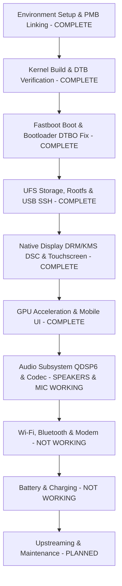

# OnePlus 7 Pro (`guacamole`) Nura Porting Plan

This roadmap outlines the bringup, integration, and testing workflow for running **Nura / postmarketOS** on the **OnePlus 7 Pro** (Qualcomm Snapdragon 855 / SM8150), detailing completed milestones and outlining our active development tasks.

---

## Technical Specifications Target

| Component | Specification |
| :--- | :--- |
| **SoC** | Qualcomm Snapdragon 855 (SM8150) |
| **CPU** | 8x Kryo 485 (1x 2.84 GHz Prime + 3x 2.42 GHz Gold + 4x 1.78 GHz Silver) |
| **GPU** | Qualcomm Adreno 640 (`qcom,adreno-640.1`) |
| **RAM** | 6 GB / 8 GB / 12 GB LPDDR4X |
| **Storage** | 128 GB / 256 GB UFS 3.0 (4096-byte sector size, `/dev/sda` - `/dev/sdf`) |
| **Display** | 6.67" Fluid AMOLED 3120x1440 (19.5:9), 90Hz Command-Mode DSC |
| **Digitizer** | Samsung `s6sy761` I2C Touchscreen (`&i2c17` at `0x48`) |
| **Audio Codec** | Qualcomm WCD9340 / WCD9341 via QDSP6 ADSP |
| **Architecture** | `aarch64` |
| **Access Method** | USB Ethernet Gadget (`172.16.42.1`) + Wayland/Phosh GUI |

---

## Bringup Phase Overview

---

## Detailed Status by Phase

### Environment Setup & Package Linking
- [x] Configure repository directory structure (`device/`, `dts/`, `firmware/`, `scripts/`, `docs/`).
- [x] Pull and import upstream device tree and device integration packages.
- [x] Initialize `pmbootstrap` configuration (`~/.config/pmbootstrap_v3.cfg`).
  - Work path: `~/.local/var/pmbootstrap`
  - Vendor: `oneplus`, Device: `guacamole`, Kernel: `postmarketos-qcom-sm8150`
- [x] Symlink local package folders into `aports`:
  - `device/testing/device-oneplus-guacamole`
  - `device/testing/firmware-oneplus-guacamole`
  - `device/testing/linux-postmarketos-qcom-sm8150`

---

### Kernel Build & DTB Verification
- [x] Verified `sm8150-oneplus-guacamole.dtb` in mainline kernel tree.
- [x] Built `firmware-oneplus-guacamole` package (GPU zap shader, WCN3990 WiFi data, modem FW).
- [x] Built `device-oneplus-guacamole` package.
- [x] Assembled rootfs and generated initramfs via `pmbootstrap install`.

---

### Bootloader Mechanics & DTBO Zeroing
- [x] Diagnosed early boot stall: OnePlus ABL dynamically injected `/dev/block/by-name/dtbo_b` Qualcomm BSP overlays into RAM, corrupting mainline DTB nodes.
- [x] Backed up stock DTBO partition to `backups/dtbo_b.img`.
- [x] Zeroed active slot DTBO (`dd if=/dev/zero of=/dev/block/by-name/dtbo_b`), allowing clean mainline DTB execution.
- [x] Verified EFI stub decompression, SMP bringup on all 8 Kryo cores, and successful initramfs execution.

---

### UFS Storage, Rootfs & USB Gadget Networking
- [x] UFS 3.0 detection verified via `ufshcd-qcom` (`/dev/sda` through `/dev/sdf`).
- [x] Rootfs deployed on `/dev/sda13` (inactive slot `_a`), completely preserving stock Android on slot `_b`.
- [x] Configured USB Ethernet gadget networking (`cdc_ncm` / `rndis`).
- [x] Direct SSH access operational at `ssh user@172.16.42.1`.

---

### Display (DRM/KMS DSC) & Touchscreen Bringup
- [x] **Samsung Command-Mode DSC Display**:
  - Replaced frozen `simplefb` with native DRM/KMS `panel-samsung-oneplus-dsc` driver.
  - Patched MSM DSI host driver (`dsi_host.c`) for 2 DSC slices per packet (720px each for 1440px width).
  - Configured 1440x3120 Fluid AMOLED panel running at native 90Hz.
- [x] **Samsung S6SY761 Touchscreen**:
  - Mapped `vdd-supply` and `avdd-supply` to PM8150 LDO 17 (`vreg_l17a_3p0`, 3.0V).
  - Configured GPIO 119 pull-up to enable the 1.8V digital rail.
  - Digitizer registered on `/dev/input/event1` with multi-touch support.

---

### GPU Hardware Acceleration & Phosh UI
- [x] Adreno 640 hardware acceleration operational:
  - GMU firmware `a640_gmu.bin` (v2.0.261) and SQE firmware `a630_sqe.fw` loaded.
  - Secure ZAP shader `a640_zap.mdt` authenticated into `zap-shader` memory.
  - DRM/KMS Freedreno OpenGL ES 3.2 and Mesa Turnip Vulkan 1.3 drivers active.
- [x] Phosh / Phoc Wayland shell running at 90 Hz.

---

### Audio Subsystem Bringup
- [x] **ADSP Remoteproc Enablement**
  - Verified Hexagon ADSP PAS firmware (`adsp.mdt`, `adsp.b*`) loads.
  - Remote processor `remoteproc1` (adsp) confirmed in `running` state.
- [x] **Sound Card & QDSP6 Audio Routing**
  - Populated `q6asmdai` sessions (`dai@0` through `dai@5`) resolving probe failure `-22`.
  - Added labels and DAIs for `q6afedai`, `q6afecc`, and `q6routing`.
  - Configured SM8150 sound card node (`qcom,sm8150-sndcard`) with MultiMedia 1-6 frontend links.
- [x] **Codec Hardware Integration**
  - Enabled SLIMbus NGD controller (`qcom,slim-ngd-v2.1.0`) at `slim-ngd@171c0000`.
  - Configured Qualcomm WCD9340 ("Tavil") audio codec node (`slim217,250`) on SLIMbus with GPIO 123 IRQ, GPIO 143 reset, and 1.8V PM8150 S4 power rail.
  - Linked SLIMbus Playback/Capture 1 & 2 to WCD9340 AIF1 and AIF2.
  - Rebuilt boot image `build/boot.img` with patched DTS.
- [x] **Stereo Speakers (NXP TFA9874 x2)** — verified 2026-10-11
  - Loudspeakers are not on the WCD9340: two NXP TFA9874 amplifiers (rev `0x0c74`) at I2C `0x34` (top/earpiece, slot 0) and `0x35` (bottom, slot 1) on `i2c@890000` (QUP0 SE4), fed by `QUATERNARY_MI2S_RX` (GPIO 137-140, data on SD1).
  - Stock `/vendor/firmware/tfa98xx.cnt` and `mixer_paths_tavil.xml` (copied to `build/audio_ref/stock_vendor_b/`) match the OnePlus 7T Pro (`hotdog`) profile exactly; ported its `tfa9874` driver and SM8150 MI2S backend as kernel patches `0007`/`0008` (S24_LE, 48 kHz, 3.072 MHz BCLK).
  - Left/right channels verified with the GNOME sound test.
- [x] **Internal Microphone** — verified 2026-10-11
  - OxygenOS `handset-mic` path: AMIC4 → ADC4 → DEC0 → SLIM TX0 → `SLIMBUS_0_TX` → MultiMedia2 (PCM 1), biased by MIC BIAS1.
  - Fixed `sm8150_dai_init()` only mapping the first SLIMbus link (capture was otherwise silent).
- [x] **UCM2 & Sound Server**
  - `device-oneplus-guacamole` installs `conf.d/sm8150/OnePlus 7 Pro.conf` + `OnePlus/guacamole/HiFi.conf` (Speaker + Mic). PulseAudio exposes `HiFi__Speaker__sink` / `HiFi__Mic__source`.
- [ ] **Remaining audio work**
  - Earpiece-only "receiver" profile for calls (top TFA, stock `handset` path) and voice call routing (depends on the modem bringup).
  - Secondary/ANC microphones (AMIC1/AMIC3/AMIC5) and noise-suppression dual-mic capture.
  - Speaker protection (stock uses ADSP feedback via `QUAT_MI2S` TX / VI sense); conservative default volume and thermal testing.
  - Resolve PulseAudio and PipeWire/WirePlumber both running (pick one; install `pipewire-pulse` if PipeWire).
  - WCD934x SoundWire controller probe fails `-22` (harmless: no WSA amps on this phone).
  - Remove the stray unpackaged UCM files on the device (`/usr/share/alsa/ucm2/Qualcomm/sm8150/`, `conf.d/sm8150/sm8150.conf`, `conf.d/OnePlus 7 Pro/`) that route speakers via SLIMbus.

---

### Wi-Fi, Bluetooth & Modem Bringup
Firmware and userspace pieces are packaged, but none of these subsystems are working yet.

- [ ] **Modem / MPSS remoteproc**
  - Bring up the Hexagon MPSS PAS remoteproc with `modem.mdt` / `modem.b*` from `firmware-oneplus-guacamole`.
  - Confirm `rmtfs` is serving the `rmtfs-mem` region and `pd-mapper` / `tqftpserv` are running.
  - Verify the `guacamole-mpss.initd` service and that the remoteproc reaches `running` without crashing.
- [ ] **WCN3990 Wi-Fi (`ath10k_snoc`)**
  - Depends on the modem step above: the WLAN firmware (`wlanmdsp.mbn`) runs on the modem DSP.
  - Verify `ath10k_snoc` probe, `board-2.bin` / `board.bin` calibration loading, and `wlan0` creation.
  - Scan and associate via NetworkManager.
  - Verify WoWLAN sleep/wake (`90-wifi-wowlan.conf`, `90-ath10k-wowlan.rules`, `10-wifi-wowlan`).
- [ ] **WCN3990 Bluetooth (`hci_qca`)**
  - Enable the `qcom,wcn3990-bt` node on its QUP UART with the correct WCN3990 regulators.
  - Package and load the Bluetooth firmware (`crbtfw*.tlv`, `crnv*.bin`).
  - Verify `hci0` registration, scanning, and pairing with `bluetoothctl`.
- [ ] **Cellular data & calls**
  - Verify QMI/QRTR modem exposure and ModemManager detection.
  - Test SIM detection, SMS, mobile data, and voice calls (voice audio depends on the audio subsystem work).

---

### Battery & Charging
Battery percentage reads 0% even while plugged in. Known DTS gaps in `base_guacamole_working.dts`:
there is no fuel gauge node (stock DTB has `bq27541-battery@55`), and the PM8150B `charger@1000` node is `status = "disabled"`.

- [ ] **Fuel gauge**
  - Add the external fuel gauge at I2C address `0x55` (bus and pins per `extracted_dtb/device.dts`).
  - Check the register layout: on the OnePlus 7T Pro (`hotdog-linux-bringup` patch 0054) the "bq27541" part actually matches the `ti,bq27411` / bq27421 map. Reading it as bq27541 gives wrong capacity.
  - Verify `/sys/class/power_supply/*/capacity`, `voltage_now`, `current_now` and `temp` report sane values.
- [ ] **PM8150B charger**
  - Enable `charger@1000` and confirm the `pm8150b-charger` power supply appears and reports `Charging` when plugged in.
  - Check the USB Type-C / VBUS detection path (`qcom,pm8150b-typec`).
- [ ] **Charging control daemon**
  - Update `guacamole-chgctrl.daemon` paths (`bq27541-0`, `pm8150b-charger`) to match the actual power-supply names.
  - Verify the 40–80% charge limit behaviour and that UPower / Phosh show the correct percentage.

---

### Upstreaming & Maintenance
- [ ] Clean up kernel patches for upstream submission to `soc/qualcomm-sm8150/linux`.
- [ ] Prepare `device-oneplus-guacamole` merge request on postmarketOS GitLab (`pmaports`).
- [ ] Document final DTS properties and firmware extraction steps on postmarketOS wiki.
