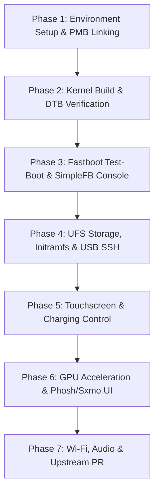

# OnePlus 7 Pro (`guacamole`) Nura Porting Plan

This roadmap outlines the bringup, integration, and testing workflow for running **Nura** (formerly postmarketOS) on the **OnePlus 7 Pro** (Qualcomm Snapdragon 855 / SM8150), taking full advantage of upstream community achievements by **Caleb Connolly** (`calebccff`) and **M1DNYT3**.

---

## Technical Specifications Target

| Component | Specification |
| :--- | :--- |
| **SoC** | Qualcomm Snapdragon 855 (SM8150) |
| **CPU** | 8x Kryo 485 (1x 2.84 GHz Prime + 3x 2.42 GHz Gold + 4x 1.78 GHz Silver) |
| **GPU** | Qualcomm Adreno 640 |
| **RAM** | 6 GB / 8 GB / 12 GB LPDDR4X |
| **Storage** | 128 GB / 256 GB UFS 3.0 (4096-byte sector size) |
| **Display** | 6.67" Fluid AMOLED 3120x1440 (19.5:9), 90Hz |
| **Digitizer** | Samsung `s6sy761` I2C Touchscreen (`&i2c17` at `0x48`) |
| **Architecture** | `aarch64` |
| **Flash Method** | Android Fastboot (standard A/B partition layout, non-super) |

---

## Existing Upstream Artifacts Discovered

Thanks to prior development in the Nura/pmOS community, key foundational pieces have already been written and are now integrated into this repository:

1. **Mainline Device Tree (Caleb Connolly)**:
   - File: [`dts/sm8150-oneplus-guacamole.dts`](file:///home/emily/Documents/Code_Workspace/guacamole_nura/dts/sm8150-oneplus-guacamole.dts) & [`dts/sm8150-oneplus-common.dtsi`](file:///home/emily/Documents/Code_Workspace/guacamole_nura/dts/sm8150-oneplus-common.dtsi)
   - Source: [`soc/qualcomm-sm8150/linux`](https://gitlab.postmarketos.org/soc/qualcomm-sm8150/linux/-/blob/sm8150/6.17/arch/arm64/boot/dts/qcom/sm8150-oneplus-guacamole.dts)
   - Pre-configured:
     - Exact memory reserves (`rmtfs_mem`, `adsp_mem`, `mpss_mem`, `venus_mem`, `slpi_mem`, `ipa_fw_mem`, `gpu_mem`, `cdsp_mem`).
     - SimpleFB framebuffer at `0x9C000000` (1440×3120).
     - Samsung `s6sy761` touchscreen driver on `&i2c17`.
     - PMIC RPMh regulators (`pm8150`, `pm8150a`, `pm8150l`).

2. **Firmware Packaging (M1DNYT3)**:
   - Package: [`device/testing/firmware-oneplus-guacamole`](file:///home/emily/Documents/Code_Workspace/guacamole_nura/device/testing/firmware-oneplus-guacamole/APKBUILD)
   - Covers:
     - Adreno 640 GPU zap shader (`a640_zap.mdt`, `a640_zap.b00` - `b02`).
     - WCN3990 Wi-Fi calibration (`board.bin`, `board-2.bin`).
     - Hexagon MPSS modem firmware slices (`modem.mdt`, `modem.b00` - `b31`).
     - WLAN Protection Domain / DSP firmware (`wlanmdsp.mbn`, `modemuw.jsn`).
     - Initramfs early GPU firmware loader config (`30-gpu-firmware.files`).

3. **Device Daemons & Scripts (M1DNYT3)**:
   - Charging control daemon and OpenRC service: `guacamole-chgctrl.daemon`, `guacamole-chgctrl.initd`.
   - Modem MPSS boot service: `guacamole-mpss.initd`.
   - Wi-Fi Wake-on-WLAN rules & dispatcher: `90-wifi-wowlan.conf`, `90-ath10k-wowlan.rules`, `10-wifi-wowlan`.
   - Sxmo hardware key profile: `sxmo_deviceprofile-oneplus-guacamole.sh`.

---

## Revised Bringup Roadmap

---

### Phase 1: Environment Setup & Package Linking
- [x] Configure repository directory structure (`device/`, `dts/`, `firmware/`, `scripts/`, `docs/`).
- [x] Pull and import upstream device tree and device integration packages.
- [ ] Initialize `pmbootstrap init`:
  - Work path: `~/.local/var/pmbootstrap`
  - Vendor: `oneplus`
  - Device: `guacamole`
  - Kernel: `postmarketos-qcom-sm8150`
- [ ] Symlink local package folders into `aports`:
  - `device/testing/device-oneplus-guacamole`
  - `device/testing/firmware-oneplus-guacamole`
  - `device/testing/linux-postmarketos-qcom-sm8150`

---

### Phase 2: Kernel Build & DTB Verification
- [ ] Build SM8150 mainline kernel using `linux-postmarketos-qcom-sm8150`:
  - Kernel source: `https://gitlab.postmarketos.org/soc/qualcomm-sm8150/linux` (branch `sm8150/6.17`).
  - Verify that `sm8150-oneplus-guacamole.dtb` is generated during `make dtbs`.
- [ ] Run `pmbootstrap build linux-postmarketos-qcom-sm8150`.
- [ ] Run `pmbootstrap build firmware-oneplus-guacamole`.
- [ ] Run `pmbootstrap build device-oneplus-guacamole`.

---

### Phase 3: Fastboot Test-Boot & SimpleFB Console
- [ ] Generate boot image:
  - `pmbootstrap flasher boot` or `pmbootstrap export`.
- [ ] Non-destructive boot testing:
  - Put OnePlus 7 Pro into Fastboot mode.
  - Test boot with `./scripts/flash_boot.sh test` (`fastboot boot boot.img`).
- [ ] Verify SimpleFB display handoff (OnePlus logo -> Linux splash / tty console).
- [ ] If reboot occurs, use `./scripts/ramoops.sh` to retrieve `/sys/fs/pstore` panic logs.

---

### Phase 4: UFS Storage, Initramfs & USB SSH
- [ ] Verify UFS 3.0 detection in kernel dmesg:
  - `ufshcd-qcom` driver probe.
  - Sector size 4096 operation.
- [ ] Establish USB Ethernet gadget networking:
  - Verify `rndis` / `cdc_ether` interface creation.
  - Connect to initramfs via SSH: `ssh root@172.16.42.1`.

---

### Phase 5: Touchscreen & Charging Control Bringup
- [ ] Samsung `s6sy761` touchscreen validation:
  - Verify `&i2c17` probe and `/dev/input/event*` generation with `evtest`.
- [ ] Battery charging and thermal management:
  - Test `guacamole-chgctrl.daemon` service.
  - Verify charging limit and thermal throttle behavior.

---

### Phase 6: GPU Acceleration & Mobile UI
- [ ] Adreno 640 GPU acceleration:
  - Verify `a640_zap.mdt` loading via `firmware-oneplus-guacamole`.
  - Validate Mesa Turnip / Freedreno DRI driver (`card0`).
- [ ] Install mobile desktop environment:
  - Test Phosh (`pmbootstrap install --ui phosh`) and Sxmo (`pmbootstrap install --ui sxmo`).
  - Flash rootfs to userdata or test from external media.

---

### Phase 7: Wi-Fi, Audio & Upstreaming
- [ ] WCN3990 Wi-Fi bringup:
  - Test firmware loading with `wlanmdsp.mbn` and `board-2.bin`.
  - Verify WoWLAN sleep/wake functionality (`10-wifi-wowlan`).
- [ ] Hexagon Audio & Voice integration:
  - PipeWire / ALSA routing via QDSP6.
- [ ] Upstreaming:
  - Finalize merge request for `device-oneplus-guacamole` on Nura / postmarketOS GitLab.
