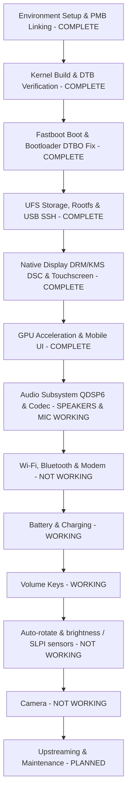

# OnePlus 7 Pro (`guacamole`) Nura Porting Plan

This roadmap outlines the bringup, integration, and testing workflow for running **Nura / postmarketOS** on the **OnePlus 7 Pro** (Qualcomm Snapdragon 855 / SM8150), detailing completed milestones and outlining our active development tasks.

---

## Technical Specifications Target

| Component | Specification |
| :--- | :--- |
| **SoC** | Qualcomm Snapdragon 855 (SM8150) |
| **CPU** | 8x Kryo 485 (1x 2.84 GHz Prime + 3x 2.42 GHz Gold + 4x 1.78 GHz Silver) |
| **GPU** | Qualcomm Adreno 640 (`qcom,adreno-640.1`) |
| **RAM** | 6 GB / 8 GB / 12 GB LPDDR4X |
| **Storage** | 128 GB / 256 GB UFS 3.0 (4096-byte sector size, `/dev/sda` - `/dev/sdf`) |
| **Display** | 6.67" Fluid AMOLED 3120x1440 (19.5:9), 90Hz Command-Mode DSC |
| **Digitizer** | Samsung `s6sy761` I2C Touchscreen (`&i2c17` at `0x48`) |
| **Audio Codec** | Qualcomm WCD9340 / WCD9341 via QDSP6 ADSP |
| **Architecture** | `aarch64` |
| **Access Method** | USB Ethernet Gadget (`172.16.42.1`) + Wayland/Phosh GUI |

---

## Bringup Phase Overview

---

## Detailed Status by Phase

### Environment Setup & Package Linking
- [x] Configure repository directory structure (`device/`, `dts/`, `firmware/`, `scripts/`, `docs/`).
- [x] Pull and import upstream device tree and device integration packages.
- [x] Initialize `pmbootstrap` configuration (`~/.config/pmbootstrap_v3.cfg`).
  - Work path: `~/.local/var/pmbootstrap`
  - Vendor: `oneplus`, Device: `guacamole`, Kernel: `postmarketos-qcom-sm8150`
- [x] Symlink local package folders into `aports`:
  - `device/testing/device-oneplus-guacamole`
  - `device/testing/firmware-oneplus-guacamole`
  - `device/testing/linux-postmarketos-qcom-sm8150`

---

### Kernel Build & DTB Verification
- [x] Verified `sm8150-oneplus-guacamole.dtb` in mainline kernel tree.
- [x] Built `firmware-oneplus-guacamole` package (GPU zap shader, WCN3990 WiFi data, modem FW).
- [x] Built `device-oneplus-guacamole` package.
- [x] Assembled rootfs and generated initramfs via `pmbootstrap install`.

---

### Bootloader Mechanics & DTBO Zeroing
- [x] Diagnosed early boot stall: OnePlus ABL dynamically injected `/dev/block/by-name/dtbo_b` Qualcomm BSP overlays into RAM, corrupting mainline DTB nodes.
- [x] Backed up stock DTBO partition to `backups/dtbo_b.img`.
- [x] Zeroed active slot DTBO (`dd if=/dev/zero of=/dev/block/by-name/dtbo_b`), allowing clean mainline DTB execution.
- [x] Verified EFI stub decompression, SMP bringup on all 8 Kryo cores, and successful initramfs execution.

---

### UFS Storage, Rootfs & USB Gadget Networking
- [x] UFS 3.0 detection verified via `ufshcd-qcom` (`/dev/sda` through `/dev/sdf`).
- [x] Rootfs deployed on `/dev/sda13` (`system_a`, inactive slot `_a`), preserving stock Android on slot `_b`. It was later reinstalled on `userdata` (LUN 0, partition 19) to use the full storage.
- [x] UFS write integrity at HS-G3 (kernel patch `0010`) — verified 2026-10-11
  - At HS-G4 the link took repeated data-link TCx replay (`saved_uic_err 0x4`) and PA (`0x40`) errors; each recovery completed in-flight commands with `OCS invalid` and buffered writes were lost (96 KiB runs read back as zeros). This corrupted downloads, the module index, `/etc/apk/world` and firmware files.
  - Verified with 4 × 1 GiB patterned buffered writes after `drop_caches`: HS-G4 232 bad blocks / 20 UFS error recoveries / 191 `OCS invalid`; HS-G3 0 / 0 / 0. O_DIRECT writes were always intact; RAM held a 5 GiB pattern cleanly; the reserved-memory map matches the stock union.
- [ ] Stable disk naming: LUN 0 is not always `sda` because the LUNs probe asynchronously, and GNOME Settings then reports the first LUN's size (for example 8.4 MB). Test `scsi_mod.scan=sync`.
- [x] Configured USB Ethernet gadget networking (`cdc_ncm` / `rndis`).
- [x] Direct SSH access operational at `ssh user@172.16.42.1`.
- [x] **USB host (OTG)** — verified 2026-10-12
  - Before: a USB thumb drive did not show up at all. The DWC3 controller (`usb@a600000`) was fixed to `dr_mode = "peripheral"`, and the PM8150B Type-C port (`typec@1500`) and VBUS regulator (`usb-vbus-regulator@1100`) were disabled.
  - Fix (device tree only; the kernel config already had `TYPEC_QCOM_PMIC`, `USB_ROLE_SWITCH`, `USB_DWC3_DUAL_ROLE` and `REGULATOR_QCOM_USB_VBUS`): enabled both PM8150B nodes, gave the Type-C port a dual-role `usb-c-connector` (`vdd-pdphy-supply` = the HS PHY 3.1 V rail, source PDO 5 V / 1.5 A, sink PDO 5 V / 3 A), switched the controller to `dr_mode = "otg"` with `usb-role-switch`, and connected the connector to the controller's HS port (data role) and to the QMP combo PHY (`orientation-switch`, SuperSpeed lanes). Modelled on `hotdog-linux-bringup` patches 0048/0049.
  - Verified: a SanDisk thumb drive (`0781:55a9`) enumerated at SuperSpeed on `xhci-hcd` and opened in Files. Attached to a PC the port reports `[sink]` / `[device]`, USB gadget SSH works and the VBUS boost stays off.
  - Not done: the FSA4480 SBU/audio switch (`i2c@890000` 0x42 in the stock DT) and DisplayPort alternate mode.

---

### Display (DRM/KMS DSC) & Touchscreen Bringup
- [x] **Samsung Command-Mode DSC Display**:
  - Replaced frozen `simplefb` with native DRM/KMS `panel-samsung-oneplus-dsc` driver.
  - Patched MSM DSI host driver (`dsi_host.c`) for 2 DSC slices per packet (720px each for 1440px width).
  - Configured 1440x3120 Fluid AMOLED panel running at native 90Hz.
- [x] **Samsung S6SY761 Touchscreen**:
  - Mapped `vdd-supply` and `avdd-supply` to PM8150 LDO 17 (`vreg_l17a_3p0`, 3.0V).
  - Configured GPIO 119 pull-up to enable the 1.8V digital rail.
  - Digitizer registered on `/dev/input/event1` with multi-touch support.

---

### GPU Hardware Acceleration & Phosh UI
- [x] Adreno 640 hardware acceleration operational:
  - GMU firmware `a640_gmu.bin` (v2.0.261) and SQE firmware `a630_sqe.fw` loaded.
  - Secure ZAP shader `a640_zap.mdt` authenticated into `zap-shader` memory.
  - DRM/KMS Freedreno OpenGL ES 3.2 and Mesa Turnip Vulkan 1.3 drivers active.
- [x] Phosh / Phoc Wayland shell running at 90 Hz.

---

### Audio Subsystem Bringup
- [x] **ADSP Remoteproc Enablement**
  - Verified Hexagon ADSP PAS firmware (`adsp.mdt`, `adsp.b*`) loads.
  - Remote processor `remoteproc1` (adsp) confirmed in `running` state.
- [x] **Sound Card & QDSP6 Audio Routing**
  - Populated `q6asmdai` sessions (`dai@0` through `dai@5`) resolving probe failure `-22`.
  - Added labels and DAIs for `q6afedai`, `q6afecc`, and `q6routing`.
  - Configured SM8150 sound card node (`qcom,sm8150-sndcard`) with MultiMedia 1-6 frontend links.
- [x] **Codec Hardware Integration**
  - Enabled SLIMbus NGD controller (`qcom,slim-ngd-v2.1.0`) at `slim-ngd@171c0000`.
  - Configured Qualcomm WCD9340 ("Tavil") audio codec node (`slim217,250`) on SLIMbus with GPIO 123 IRQ, GPIO 143 reset, and 1.8V PM8150 S4 power rail.
  - Linked SLIMbus Playback/Capture 1 & 2 to WCD9340 AIF1 and AIF2.
  - Rebuilt boot image `build/boot.img` with patched DTS.
- [x] **Stereo Speakers (NXP TFA9874 x2)** — verified 2026-10-11
  - Loudspeakers are not on the WCD9340: two NXP TFA9874 amplifiers (rev `0x0c74`) at I2C `0x34` (top/earpiece, slot 0) and `0x35` (bottom, slot 1) on `i2c@890000` (QUP0 SE4), fed by `QUATERNARY_MI2S_RX` (GPIO 137-140, data on SD1).
  - Stock `/vendor/firmware/tfa98xx.cnt` and `mixer_paths_tavil.xml` (copied to `build/audio_ref/stock_vendor_b/`) match the OnePlus 7T Pro (`hotdog`) profile exactly; ported its `tfa9874` driver and SM8150 MI2S backend as kernel patches `0007`/`0008` (S24_LE, 48 kHz, 3.072 MHz BCLK).
  - Left/right channels verified with the GNOME sound test.
- [x] **Internal Microphone** — verified 2026-10-11
  - OxygenOS `handset-mic` path: AMIC4 → ADC4 → DEC0 → SLIM TX0 → `SLIMBUS_0_TX` → MultiMedia2 (PCM 1), biased by MIC BIAS1.
  - Fixed `sm8150_dai_init()` only mapping the first SLIMbus link (capture was otherwise silent).
- [x] **UCM2 & Sound Server**
  - `device-oneplus-guacamole` installs `conf.d/sm8150/OnePlus 7 Pro.conf` + `OnePlus/guacamole/HiFi.conf` (Speaker + Mic). PulseAudio exposes `HiFi__Speaker__sink` / `HiFi__Mic__source`.
- [ ] **Remaining audio work**
  - Earpiece-only "receiver" profile for calls (top TFA, stock `handset` path) and voice call routing (depends on the modem bringup).
  - Secondary/ANC microphones (AMIC1/AMIC3/AMIC5) and noise-suppression dual-mic capture.
  - Speaker protection (stock uses ADSP feedback via `QUAT_MI2S` TX / VI sense); conservative default volume and thermal testing.
  - Resolve PulseAudio and PipeWire/WirePlumber both running (pick one; install `pipewire-pulse` if PipeWire).
  - WCD934x SoundWire controller probe fails `-22` (harmless: no WSA amps on this phone).
  - Remove the stray unpackaged UCM files on the device (`/usr/share/alsa/ucm2/Qualcomm/sm8150/`, `conf.d/sm8150/sm8150.conf`, `conf.d/OnePlus 7 Pro/`) that route speakers via SLIMbus.

---

### Wi-Fi, Bluetooth & Modem Bringup
Wi-Fi connects on 2.4 GHz and 5 GHz and Bluetooth works. Cellular is not working yet.

- [x] **Modem / MPSS remoteproc**
  - `remoteproc0` (modem) reaches `running` with `qcom/sm8150/oneplus7/modem.mdt` from `firmware-oneplus-guacamole`; `rmtfs` and `tqftpserv` are active, and the in-kernel pd-mapper replaces the userspace one.
  - The packaged modem/WLAN firmware (`WLAN.HL.3.2.0.c2-00011`) is a different OxygenOS build than the phone's own `modem_b` (`c2-00006`); both behave the same for Wi-Fi.
- [x] **WCN3990 Wi-Fi (`ath10k_snoc`)** — connects on 2.4 and 5 GHz, verified 2026-10-11
  - Supplies from the stock `qcom,icnss` node: L1A (cx-mx), L7A (1.8 V xo), L2C (1.3 V rfa), L11C (3.3 V ch0). No separate ch1 rail; stock uses L10C for audio.
  - Firmware: the OxygenOS 10/11 WLAN firmware (`WLAN.HL.3.2.0`) rejects station vdev start under mainline ath10k. `firmware-oneplus-guacamole` now ships the OxygenOS 12-era `wlanmdsp.mbn` (`WLAN.HL.3.0.c8-00232`) and board data from a LineageOS OTA (`scripts/extract_lineage_firmware.py`, local tarball next to the APKBUILD), plus `firmware-5.bin` from linux-firmware `20260810`.
  - Re-test of the sm8150-mainline GitLab firmware (2026-10-12, UFS at HS-G3): its `wlanmdsp.mbn` alone, and its full modem + `wlanmdsp.mbn` + `board-2.bin` set, both fail station vdev start (`status error: -1`) on 2.4 GHz and 5 GHz. The earlier failure was not caused by storage corruption; the LineageOS firmware stays. Note for future tests: pmOS overrides `firmware_class.path` at boot, so swap test firmware with bind mounts from an early oneshot unit instead.
  - The OxygenOS 12 modem image spans 160 MiB (`0x8dc00000-0x97c00000`) and fails with "segment outside memory range" against the 150 MiB `mpss_mem`, so the package keeps the OxygenOS 11 modem.
  - Kernel patch `0009`: skip the WMI quiet-mode command on WCN3990 (HL3.2 firmware crashed on it), backported from the linux-wireless series "ath10k: WCN3990 firmware workarounds for WLAN.HL.3.2". Its forced-passive-5 GHz half is not included.
  - Do not test by unbinding/rebinding `ath10k_snoc` or restarting a running modem: the MSA region stays assigned to the modem (`qcom_scm` assign `-22`), and rebooting from that state has put the phone into Qualcomm crashdump mode.
  - MAC address (2026-10-12): `ath10k` logs `invalid MAC address; choosing random` because neither the device tree nor the firmware carries the factory MAC. `guacamole-wlanmac` (udev `RUN+=` on the `wlan0` add event, before NetworkManager manages the device) reads `Intf0MacAddress` from `persist/wlan_mac.bin` with `debugfs` (udevd's seccomp filter blocks `mount`), caches it in `/var/lib/guacamole/wlanmac` and sets it as the interface address. NetworkManager keeps the pmOS policy (`50-random-mac.conf`): randomized scan MACs and a per-connection `stable` MAC while connected, which stays the same across reboots (verified for two saved networks). A connection can use the factory MAC with `802-11-wireless.cloned-mac-address=preserve`. The kernel `perm_addr` (NetworkManager `PermHwAddress`, used by `cloned-mac-address=permanent`) stays random; fixing that needs the MAC in the device tree before `ath10k` registers the interface.
  - Still to do: WoWLAN sleep/wake, throughput; `rmtfs` sometimes starts before `remoteproc0` registers (`failed to update start state: Invalid argument`) and the modem then needs a manual `echo start`.
- [x] **Crashdump on reboot** — fixed 2026-10-12
  - Symptom: `reboot bootloader` with Wi-Fi active sometimes dropped the phone into Qualcomm crashdump mode (2026-10-11, at least twice; recover with Power + Volume Up). Reboots with the radio off went straight to fastboot.
  - Cause: the boot firmware arms a download-mode cookie in TCSR. `qcom_scm` clears it at probe and in its shutdown hook, but the device tree had no `qcom,dload-mode`, so the driver used the `SET_DLOAD_MODE` SCM call, which does not clear the cookie on SM8150. An abnormal event during shutdown with the modem running the WLAN firmware then ended in download mode.
  - Fix: TCSR syscon `syscon@1fc0000` (size `0x30000`) and `qcom,dload-mode = <&tcsr 0x13000>` on `firmware/scm`, from `hotdog-linux-bringup` patch `0098` (downstream places the register at `0x1fd3000`).
  - Verified: reboots to fastboot with Wi-Fi connected went cleanly 3 times in a row (2 logged over SSH with distinct boot IDs, 1 observed on the device).
  - Not investigated: what fails in the modem/WLAN shutdown path. The cookie fix stops it from forcing a crashdump; the hotdog "ath10k MSA reclaim" patches (`hotdog-linux-bringup/docs/upstream-submissions.md`) address the modem-crash side.
- [ ] **Move to the OxygenOS 12 modem**: rework reserved memory so `mpss_mem` covers 160 MiB (moves `venus_mem` and the following regions; see the NetHunter Pro guacamole patch 0008).
- [x] **WCN3990 Bluetooth (`hci_qca`)**, scanning and a Bluetooth mouse verified 2026-10-12
  - UART13 (`serial@c8c000`, GPIO 43–46) with a `qcom,wcn3990-bt` child: `vddio` L1A, `vddxo` L7A, `vddrf` L2C, `vddch0` L11C, 3.2 Mbaud (same as `sm8150-google-flame` and the OnePlus 7T Pro).
  - `qcom_geni_serial` needs a `serial1` alias in `/aliases`; without it the UART fails with "Invalid line -19".
  - ROM version `0x1001` would derive rev-01 firmware names, so the node sets `firmware-name = "crnv21.bin", "crbtfw21.tlv"`. Both files come from the LineageOS `bluetooth` partition (`BTFM.CHE.2.1.5`) via `scripts/extract_lineage_firmware.py`, packaged in `firmware-oneplus-guacamole` r4.
  - The `linux-firmware` files (`20260810`: `crbtfw21.tlv` `BTFM.CHE.2.1.3`, generic `crnv21.bin`) also work: setup, scanning and a paired MX Master 3S tested 2026-10-12 by bind-mounting them and rebinding `hci_uart_qca`. They are the fallback if the LineageOS extraction is dropped; the package keeps the newer LineageOS build with OnePlus NV data.
  - The controller has no programmed address and ABL passes no `local-bd-address`, so the kernel registers it as unconfigured and BlueZ ignores it ("no adapter" in GNOME Settings). `device-oneplus-guacamole` r5 adds `guacamole-bdaddr` (udev rule and oneshot service). On first run it derives a stable address from the factory Wi-Fi MAC in `persist/wlan_mac.bin` (last byte + 1), caches it in `/var/lib/guacamole/bdaddr`, and applies it with `btmgmt public-addr` once the controller reports the address missing (it waits up to 20 s, since udev starts it before the QCA firmware setup finishes). Verified on a fresh boot 2026-10-12. The stock `persist/bluetooth` directory is empty, so the real address lives in modem NV.
  - Still to check: audio profiles (A2DP/HFP need the audio routing work), and Bluetooth/Wi-Fi coexistence under load.
- [ ] **Cellular data & calls**
  - Verify QMI/QRTR modem exposure and ModemManager detection.
  - Test SIM detection, SMS, mobile data, and voice calls (voice audio depends on the audio subsystem work).

---

### Battery & Charging
Battery percentage, charging and the plugged-in/unplugged state work. The charge-limit daemon still needs rework.

- [x] **Fuel gauge** — verified 2026-10-11
  - `ti,bq27411` at `0x55` on `i2c@a80000` (QUP1 SE8, GPIO 88/89), FIFO mode without GPI DMA, 100 kHz. Stock names it `bq27541`, but the registers follow the bq27411/bq27421 layout (as found on the OnePlus 7T Pro, `hotdog-linux-bringup` patch 0054).
  - No `monitored-battery` property, and `CONFIG_BATTERY_BQ27XXX_DT_UPDATES_NVM` is off, so the factory-programmed gauge data memory is never written.
  - Reports capacity, voltage, current, temperature, `charge_full` 2977 mAh vs. 3940 mAh design. UPower/Phosh show the percentage.
  - Still to check: unplugged discharge (negative current, percentage falling in step with `charge_now`). The first readings were taken at 100% after a day on USB.
  - The OnePlus Warp fast-charge MCU at `0x26` on the same bus is intentionally not described.
- [x] **PM8150B charger (SMB5)**, verified 2026-10-12
  - Kernel patch `0011`: `qcom_smbx` used SMB2 conversions on SMB5 hardware (about 4.85 V / 3.9 A on PM8150B). It now uses generation-specific ranges, keeps charging and USB input suspended until the limits are programmed, defines the SMB5 ICL bits and reruns AICL after ICL changes. Backported from `hotdog-linux-bringup` patches 0020, 0155 and 0150; 0151/0152 do not apply to this base.
  - `simple-battery` node with conservative limits below stock (stock `fv-max-uv` 4.365 V; `OP_4000mAh` profile 4.37 V and 3.0 A): 4.35 V float, 1.5 A fast charge, 310 mA termination, 4000 mAh. `charger@1000` is enabled with `monitored-battery`. The PM8150B fuel gauge stays disabled because the bq27411 is the battery source.
  - Registers read back through `/sys/kernel/debug/regmap/0-02/registers`: `0x1070` = `0x4b` (4.35 V), `0x1061` = `0x1e` (1.5 A), `0x1370` = `0x0a` (500 mA ICL on a PC SDP port), `0x1006` = fast-charge state.
  - Kernel patch `0012` with `power-supplies = <&pm8150b_charger>` on the gauge: the bq27411 kept its full-charge flag after unplugging, so it reported `Full` while discharging and UPower/Phosh still showed the charging bolt. It now reports `Full` only while the charger is online.
  - Still to check: charging from a wall charger (DCP detection and a higher ICL), thermal behaviour while charging, and raising the fast-charge current towards stock once that is validated.
- [ ] **Charging control daemon**
  - `guacamole-chgctrl.daemon` reads `/sys/class/power_supply/bq27541-0/capacity`; the device is now `bq27411-0`.
  - It writes `0`/`2` to `pm8150b-charger/status`, which is read-only on mainline. Rework it against the charger driver's actual controls (e.g. `charge_behaviour` or the input current limit).

---

### GNOME Settings About Page
- [ ] **Processor name**: arm64 `/proc/cpuinfo` has no `model name`, so the field is blank. It should read "Qualcomm Snapdragon 855 (SM8150)". Needs a libgtop or gnome-control-center fallback, or a local kernel patch that adds `model name` for `qcom,sm8150`.
- [ ] **Graphics name**: Mesa freedreno reports the GL renderer as `FD640`. It should read "Qualcomm Adreno 640". Needs a Mesa renderer-name change or a gnome-control-center `info_cleanup` rule.

### Sensors
- [ ] **Auto-rotate (accelerometer)**
  - The stock device tree has no accelerometer on an AP-visible bus; the motion sensors sit behind the SLPI sensor DSP (Qualcomm SSC).
  - Needs the SLPI remoteproc, the sensor firmware/registry, and an SSC client in userspace feeding `iio-sensor-proxy`. Reference: `hotdog-linux-bringup/docs/evidence/*slpi*`, `*sensor*` (OnePlus 7T Pro).

- [ ] **Automatic brightness (ambient light sensor)**
  - The stock device tree has no ambient light sensor on an AP-visible bus; like the accelerometer it is reached through the SLPI sensor DSP. On the OnePlus 7T Pro it is a TCS3701 (light and proximity); identify the 7 Pro part from the SLPI sensor registry.
  - Same dependency as auto-rotate: SLPI remoteproc, sensor registry, an SSC client feeding `iio-sensor-proxy`. Reference: `hotdog-linux-bringup/docs/evidence/*alsps*`, `*tcs3701*`, `*als-type*`.

### Camera
- [ ] **Cameras**
  - The stock device tree describes several `qcom,cam-sensor` slots (rear main/wide/telephoto and the pop-up front camera) on the CCI buses.
  - Needs SM8150 CAMSS support, the CCI controllers, camera PMIC rails and sensor drivers. Reference: `hotdog-linux-bringup` patches `0055`–`0064` (OnePlus 7T Pro: CAMSS for SM8150, CCI, `s5k3m5` driver, slot identification); the 7 Pro sensor models still need identifying from the stock DT/vendor partition.
  - The pop-up front camera also needs its motor driver.

### Buttons
- [x] **Volume keys** — verified 2026-10-11
  - `gpio-keys` on PM8150 GPIO 6 (volume up) and GPIO 7 (volume down), active low, pull-up, `power-source = <1>`, as in the stock `gpio_keys` node. The OnePlus 7T Pro uses the PON `resin` key for volume down instead; the 7 Pro does not.

---

### Upstreaming & Maintenance
- [ ] Clean up kernel patches for upstream submission to `soc/qualcomm-sm8150/linux`.
- [ ] Prepare `device-oneplus-guacamole` merge request on postmarketOS GitLab (`pmaports`).
- [ ] Document final DTS properties and firmware extraction steps on postmarketOS wiki.
